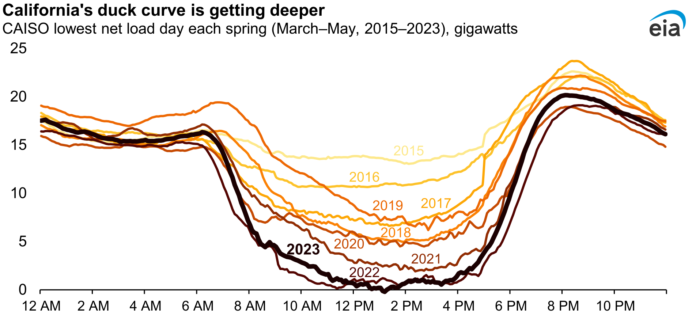

```{julia}
#| output: false
import Pkg
Pkg.activate(@__DIR__)
Pkg.instantiate()
```

```{julia}
#| output: false
using Plots
using StatsPlots
using Measures
using LaTeXStrings
using JuMP
using HiGHS
using CSV
using DataFrames

plot_font = "Palatino Roman"
default(
    fontfamily=plot_font,
    linewidth=3,
    framestyle=:box,
    label=nothing,
    grid=false,
    guidefontsize=18,
    legendfontsize=16,
    tickfontsize=16,
    titlefontsize=20,
    bottom_margin=10mm,
    left_margin=5mm
)

# Okabe-Ito palette: distinguishable under all common types of colour
# blindness, and every pair also differs in line style so the figures
# still read in greyscale.
cb_orange = "#E69F00"
cb_green = "#009E73"
cb_yellow = "#F0E442"
cb_blue = "#0072B2"
cb_vermillion = "#D55E00"
cb_purple = "#CC79A7"
cb_sky = "#56B4E9"

# Whole numbers with thousands separators, for dollar amounts in text
commas(n) = replace(string(Int(round(n))), r"(?<=\d)(?=(\d{3})+$)" => ",")
```

```{julia}
#| output: false

# The fleet: 12 dispatchable plants, plus wind and solar (used in the multi-period part)
gens = DataFrame(CSV.File("data/economic_dispatch/generators.csv"))
n_thermal = nrow(gens) - 2          # every plant except wind and solar
thermal = 1:n_thermal
demand_mw = 2200                    # one hour's demand [MW]
```

# Review

## Shadow Prices

A **shadow price** is the **marginal** change in the objective for an LP when a constraint is relaxed by one unit.

For example:

- What is the value in mitigation avoided of increasing the maximum allowable emissions by one ton?
- How much more profit could be earned from the purchase or leasing of one more acre of land?


# Electric Power System Decision Problems

## Overview of Electric Power Systems


::: {.caption}
Source: [Wikipedia](https://en.wikipedia.org/wiki/Electric_power_transmission)
:::

::: {.notes}
Walk through the chain: generation, step-up transformers, high-voltage transmission, substations, distribution, customers. Today is about the first box: which plants generate, and how much, to meet the load at each moment.
:::

## Decision Problems for Power Systems


::: {.caption}
Adapted from Perez-Arriaga, Ignacio J., Hugh Rudnick, and Michel Rivier (2009)
:::

::: {.notes}
Decisions sit on different time scales: what to build (years: capacity expansion), which plants to commit (a day ahead: unit commitment), and how much each running plant generates (hours to minutes: economic dispatch). The same LP tools show up at every scale.
:::

## Electricity Generation by Source


::: {.notes}
The US mix: natural gas is the largest source, then nuclear, coal and renewables. Gas plants come in two kinds that matter today: efficient combined-cycle plants (CCGT) that run for long stretches, and cheaper-to-build but more expensive-to-run combustion turbines (CT) that run only when needed.
:::

# Single-Period Economic Dispatch

## Economic Dispatch

**Decision problem**: how much should each running plant produce to meet demand at lowest cost?

::: {.fragment .fade-in}
| Variable | Meaning |
|:-----:|:---------------|
| $d$ | demand this hour (MW) |
| $y_g$ | generation of plant $g$ (MW) |
| $\text{VarCost}_g$ | variable cost of plant $g$ (\$/MWh) |
| $P^{\text{min/max}}_g$ | minimum and maximum output of $g$ (MW) |
:::

::: {.notes}
Ask the room what the decision variables are before revealing the table. The answer: one generation level per plant. Demand, costs and limits are data. Plants also face engineering constraints: minimum outputs, ramping limits, and in real systems transmission limits, which we leave out.
:::

## Where Variable Costs Come From

:::: {.columns}
::: {.column width=55%}
- labor and equipment upkeep;
- **fuel** (the big one), converted to \$/MWh by the plant's efficiency, its **heat rate**.

Cost curves are really slightly *quadratic*; we use a linear (or piecewise linear) approximation.
:::
::: {.column width=45%}


::: {.caption}
Source: [Ross Baldick, UT Austin](https://users.ece.utexas.edu/~baldick/classes/394V/Dispatch.pdf)
:::
:::
::::

::: {.notes}
The heat rate is how much fuel energy a plant burns per MWh of electricity. A plant with a lower heat rate (more efficient) has a lower variable cost for the same fuel price. The curve on the right bends upward because efficiency changes with output; a linear approximation is good enough for dispatch over the normal operating range.
:::

## The Single-Period Problem

Write the economic dispatch problem for one hour.

::: {.fragment .fade-in}
$$
\begin{aligned}
\min_{\mathbf{y}} \quad & \sum_{g \in \mathcal{G}} \text{VarCost}_g \, y_g \\
\text{subject to:} \quad & \sum_{g \in \mathcal{G}} y_g = d \\[0.3em]
& y_g \leq P^{\text{max}}_g \qquad \forall g \in \mathcal{G} \\[0.3em]
& y_g \geq P^{\text{min}}_g \qquad \forall g \in \mathcal{G}
\end{aligned}
$$
:::

::: {.notes}
Board item; the answer is the fragment, so no board is needed. Give students a minute to write it, then reveal. Points to make: there is one demand constraint (a single sum over all plants, not one per plant). Generation must equal demand: we can't store electricity. Each plant has its own capacity and minimum-output constraint. Everything is linear, so it is an LP.
:::

## Example: The Fleet

```{julia}
#| echo: true
#| code-fold: true
#| output: asis

# The fleet: 12 dispatchable plants, plus wind and solar (used in the multi-period part)
gens = DataFrame(CSV.File("data/economic_dispatch/generators.csv"))
n_thermal = nrow(gens) - 2          # every plant except wind and solar
thermal = 1:n_thermal
demand_mw = 2200                    # one hour's demand [MW]

println("Demand is **$(demand_mw) MW**. The plants, at 2022 gas prices:\n")

# Summarise the fleet by type: how many plants, their capacity and cost ranges
for resource in unique(gens[thermal, :Resource])
    rows = gens[thermal, :][gens[thermal, :Resource] .== resource, :]
    n_plants = nrow(rows)
    smallest, largest = extrema(rows.Pmax)
    cheapest, dearest = extrema(rows.VarCost)
    if smallest == largest
        cap_text = "$(smallest) MW"
    else
        cap_text = "$(smallest)–$(largest) MW"
    end
    if cheapest == dearest
        cost_text = "\\\$$(cheapest)/MWh"
    else
        cost_text = "\\\$$(cheapest)–$(dearest)/MWh"
    end
    println("- $(n_plants) $(resource): $(cap_text) capacity, $(cost_text)")
end
```

::: {.notes}
One nuclear plant, `{julia} count(gens.Resource .== "NG CCGT")` combined-cycle gas plants (CCGT) and `{julia} count(gens.Resource .== "NG CT")` combustion turbines (CT), plus a biomass and a hydro plant. Hydro is cheapest to run because the water is free, and nuclear fuel is cheap, so the nuclear plant comes next. CTs are the most expensive per MWh. The gas plants' costs use the average price U.S. power plants paid for gas in 2022, \$7.21 per million Btu, about twice today's. The nuclear plant and several gas plants have minimum outputs: once on, they must produce at least that much.
:::

# Single-Period Dispatch

## Single-Period Model

```{julia}
#| echo: true
#| code-fold: false
#| output: false

# The fleet: 12 dispatchable plants, plus wind and solar (used in the multi-period part)
gens = DataFrame(CSV.File("data/economic_dispatch/generators.csv"))
n_thermal = nrow(gens) - 2          # every plant except wind and solar
thermal = 1:n_thermal
demand_mw = 2200                    # one hour's demand [MW]

dispatch = Model(HiGHS.Optimizer)
@variable(dispatch, y[g in 1:n_thermal] >= 0)
@objective(dispatch, Min, sum(gens[g, :VarCost] * y[g] for g in 1:n_thermal))
@constraint(dispatch, load, sum(y) == demand_mw)
@constraint(dispatch, capacity[g in 1:n_thermal], y[g] <= gens[g, :Pmax])
@constraint(dispatch, minimum_output[g in 1:n_thermal], y[g] >= gens[g, :Pmin])
set_silent(dispatch)
optimize!(dispatch)
```

## Single-Period Results

```{julia}
#| echo: true
#| code-fold: true

output = value.(y)

# Which plants are held at their minimum output this hour?
at_minimum = falses(n_thermal)
for g in thermal
    if gens[g, :Pmin] > 0 && output[g] <= gens[g, :Pmin] + 1e-6
        at_minimum[g] = true
    end
end

p_results = bar(gens[thermal, :Plant], output, color=cb_blue, label="dispatched",
    xrotation=45, ylabel="Generation  [MW]", ylims=(0, 650), legend=:topright)
scatter!(p_results, gens[thermal, :Plant], gens[thermal, :Pmax], markershape=:hline,
    markersize=18, markerstrokewidth=4, color=:black, label="capacity")
scatter!(p_results, gens[thermal, :Plant], gens[thermal, :Pmin], markershape=:hline,
    markersize=18, markerstrokewidth=4, color=cb_vermillion, label="minimum")
plot!(p_results, size=(1200, 460), bottom_margin=22mm, left_margin=12mm)
```

::: {.notes}
Bars are what each plant produces; black ticks are capacities and red ticks are minimum outputs. Read the pattern: the cheap plants (hydro, biomass, nuclear and the CCGTs) are at capacity. CT1 is partly loaded. CT2 to CT4 sit at their minimums. CT5 is off. The total is `{julia} demand_mw` MW at a cost of \$`{julia} commas(objective_value(dispatch))` for the hour.
:::

## The Dispatch Stack/Merit Order

```{julia}
#| echo: true
#| code-fold: true

# Minimum outputs first, then each plant's remaining capacity in order of cost
order = sortperm(gens[thermal, :VarCost])
widths = gens[thermal, :Pmax][order] .- gens[thermal, :Pmin][order]
heights = gens[thermal, :VarCost][order]
must_run = sum(gens[thermal, :Pmin])
left_edges = must_run .+ [0; cumsum(widths)[1:end-1]]
marginal = findfirst(left_edges .+ widths .>= demand_mw)
stack_price = heights[marginal]

rectangle(w, h, x) = Shape(x .+ [0, w, w, 0], [0, 0, h, h])
p_stack = plot(rectangle(must_run, 2.5, 0), color=:gray60, linewidth=0.5,
    xlabel="Cumulative capacity  [MW]", ylabel="Marginal cost  [\$/MWh]",
    xlims=(0, 2500), ylims=(0, 120), xticks=0:500:2500)
for i in eachindex(order)
    if i == marginal
        bar_color = cb_vermillion        # the plant that sets the price
    else
        bar_color = cb_blue
    end
    plot!(p_stack, rectangle(widths[i], max(heights[i], 2.5), left_edges[i]),
        color=bar_color, alpha=0.6, linewidth=0.5)
end
vline!(p_stack, [demand_mw], color=:black, linestyle=:dash, linewidth=3)
hline!(p_stack, [stack_price], color=cb_vermillion, linestyle=:dot, linewidth=3)
annotate!(p_stack, 300, 9, text("minimum outputs", 14, plot_font))
annotate!(p_stack, demand_mw + 20, 113, text("demand", 16, :left, plot_font))
annotate!(p_stack, 200, stack_price + 6, text("price: \$$(stack_price)/MWh", 16, :left, plot_font))
plot!(p_stack, size=(1200, 370), left_margin=12mm, right_margin=6mm)
```

CT1 (red) serves the next MWh, so the price is **\$`{julia} stack_price`/MWh**.

::: {.notes}
This is the merit order: plants stacked from cheapest to most expensive, after the minimum outputs that must run anyway (gray). Demand (dashed line) cuts the stack inside CT1, so CT1 is the marginal plant. If demand rose by one MWh, CT1 would produce it at \$`{julia} stack_price`, so \$`{julia} stack_price`/MWh is the price. Ask: "what happens to the price if demand rises past CT1's capacity?" Answer: the next plant in the stack, CT2 or CT3 at \$`{julia} heights[marginal + 1]`, sets it.
:::

## Shadow Price from JuMP

```{julia}
#| echo: true
#| code-fold: false
#| output: false

price = -shadow_price(load)                 # [$/MWh]
```

`shadow_price(load)` is **`{julia} round(Int, shadow_price(load))`**: relaxing demand by one unit means serving one less MWh, which saves \$`{julia} round(Int, price)`. This shadow price is the **price of electricity** in wholesale electricity markets: the cost of the plant that served the last MWh.

Generating plants don't lose money when they generate (expensive plants would lose money if the price was an average.)


::: {.notes}
The model is on the "Single-Period Model" slide: it names the demand constraint `load`, so JuMP can report its shadow price. JuMP reports what relaxing a constraint by one unit does to the cost. For demand, relaxing means serving one less MWh, so the cost falls by \$`{julia} round(Int, price)` and the shadow price is −`{julia} round(Int, price)`. The price of electricity is the size of that number. This is how wholesale markets set prices: the demand constraint's shadow price in the operator's dispatch model.
:::

## What Complicates the Merit Order?

What could make the cheapest-first rule wrong?

::: {.fragment .fade-in}
- **Minimum generation**: Plants may have to generate a minimum amount to be on.
- **Ramping limits**: output can change only so fast from hour to hour.
- **Start-up/shut-down**: starting up a plant costs money, and shutting down can keep a plant offline for hours.
- **Transmission**: cheap power may not be able to reach the load if lines are congested.
:::


# Multi-Period Dispatch

## Linking the Hours

Over many hours, plant $g$ produces $y_{g,t}$ MW in hour $t$:

::: {.small-math}
$$
\begin{aligned}
\min_{\mathbf{y}} \quad & \sum_{g \in \mathcal{G}} \sum_{t \in \mathcal{T}} \text{VarCost}_g \, y_{g,t} \\
\text{subject to:} \quad & \sum_{g \in \mathcal{G}} y_{g,t} = d_t \qquad \forall t \in \mathcal{T} \\[0.3em]
& P^{\text{min}}_g \leq y_{g,t} \leq P^{\text{max}}_g \qquad \forall g, t
\end{aligned}
$$
:::

Output can change by at most $R_g$ MW per hour. **How can we write this as one or more linear constraints?**


## Ramping Constraints

Output can change by at most $R_g$ per hour:

::: {.small-math}
$$
\begin{aligned}
\min_{\mathbf{y}} \quad & \sum_{g \in \mathcal{G}} \sum_{t \in \mathcal{T}} \text{VarCost}_g \, y_{g,t} \\
\text{subject to:} \quad & \sum_{g \in \mathcal{G}} y_{g,t} = d_t \qquad \forall t \in \mathcal{T} \\[0.3em]
& P^{\text{min}}_g \leq y_{g,t} \leq P^{\text{max}}_g \qquad \forall g, t \\[0.3em]
& \color{#D55E00}{y_{g,t+1} - y_{g,t} \leq R_g} \qquad \forall g, \ t = 1, \ldots, T-1 \\[0.3em]
& \color{#D55E00}{y_{g,t} - y_{g,t+1} \leq R_g} \qquad \forall g, \ t = 1, \ldots, T-1
\end{aligned}
$$
:::


## Ramp Limits by Plant Type

```{julia}
#| echo: true
#| code-fold: true
#| output: asis

# Each dispatchable plant type's ramp limit as a share of its capacity, slowest first
plant_types = unique(gens[thermal, :Resource])
lowest_share = zeros(length(plant_types))
highest_share = zeros(length(plant_types))
for (i, resource) in enumerate(plant_types)
    rows = gens[thermal, :][gens[thermal, :Resource] .== resource, :]
    lowest_share[i] = minimum(rows.Ramp ./ rows.Pmax)
    highest_share[i] = maximum(rows.Ramp ./ rows.Pmax)
end
for i in sortperm(lowest_share)
    lowest = round(Int, 100 * lowest_share[i])
    highest = round(Int, 100 * highest_share[i])
    if lowest == highest
        share_text = "$(lowest)%"
    else
        share_text = "$(lowest)–$(highest)%"
    end
    println("- **$(plant_types[i])**: up to $(share_text) of capacity per hour")
end
```

::: {.notes}
These are the hourly limits that planning models use. The nuclear plant can change by `{julia} round(Int, 100 * lowest_share[findfirst(plant_types .== "Nuclear")])`% of its capacity per hour, the CCGTs by `{julia} round(Int, 100 * lowest_share[findfirst(plant_types .== "NG CCGT")])`%, and everything else can cross its whole range within the hour.

Physical ramp rates are faster than these. Gas and coal plants can change by one to several percent of their capacity per minute, so a single running unit can usually cross its operating range within an hour. What limits steam plants over hours is their minimum output and the hours they take to start up, which need on/off decisions. Nuclear plants are usually run at constant output.

The clearest real case of an hourly ramp limit is hydropower below a dam with flow-change rules. At Glen Canyon Dam, releases may rise by at most 4,000 cubic feet per second in an hour and fall by at most 1,500, against a maximum of 25,000, to protect the river downstream.
:::

## Demand and Renewables on a Fall Day

```{julia}
#| echo: true
#| code-fold: true

# Demand: the shape of an October day from the New York hourly load file, raised
# to fit this fleet. Illustrative, not a real system's demand.
load_data = DataFrame(CSV.File("data/economic_dispatch/2020_hourly_load_NY.csv"))
day = 289
hours = (day * 24 + 1):((day + 1) * 24)
demand_shift = 600                                     # [MW]
hourly_demand = load_data[hours, :C] .+ demand_shift   # [MW]
capacity_factor = DataFrame(CSV.File("data/economic_dispatch/gen_variability.csv"))

p_demand = plot(1:24, hourly_demand, color=:black, xlabel="Hour", ylabel="Demand  [MW]",
    xticks=0:6:24, title="Demand")
p_cf = plot(1:24, capacity_factor.Wind, color=cb_sky, label="wind", xlabel="Hour",
    ylabel="Capacity factor", ylims=(0, 1), xticks=0:6:24, title="Wind and solar")
plot!(p_cf, 1:24, capacity_factor.Solar, color=cb_orange, linestyle=:dash, label="solar")
plot(p_demand, p_cf, layout=(1, 2), size=(1200, 330), left_margin=10mm, bottom_margin=10mm)
```

A **capacity factor** is the share of a plant's capacity the weather makes available each hour.

::: {.notes}
This is an illustrative fall day, not a record of any one system. The demand has the shape of an October day in upstate New York, raised by `{julia} demand_shift` MW to fit this fleet, and the wind and solar curves are also for an October day. Demand runs from about `{julia} commas(minimum(hourly_demand))` MW overnight to `{julia} commas(maximum(hourly_demand))` MW around midday, and is nearly as high again in the evening. Solar is zero at night and peaks at midday; wind varies through the day. The fleet has `{julia} gens[end-1, :Pmax]` MW of wind and `{julia} gens[end, :Pmax]` MW of solar.
:::

## Adding Renewables

Wind and solar enter through their capacity factors $c_{g,t}$:

$$y_{g,t} \leq P^{\text{max}}_g \times c_{g,t} \qquad \forall g \in \mathcal{G}, t \in \mathcal{T}$$

Everything else stays the same. Their variable cost is zero, so the dispatch uses all they can give, unless something else stops it.

::: {.notes}
For the dispatchable plants the capacity factor is 1 every hour. "Unless something else stops it" foreshadows the three-times-solar case later: when the zero-cost plants and the plants that must run can together supply more than demand, some free energy goes unused.
:::

## Multi-Period Results

```{julia}
#| echo: true
#| code-fold: true

n_plants = nrow(gens)
day_hours = 1:24
nuclear_row = findfirst(gens.Plant .== "Nuclear")

# Share of each plant's capacity available each hour: all of it for the dispatchable
# plants, the capacity factor for wind and solar (the last two plants)
availability = ones(n_plants, 24)
availability[n_plants-1, :] = capacity_factor.Wind
availability[n_plants, :] = capacity_factor.Solar

function solve_day(; ramp=true, solar_scale=1)
    pmax = Float64.(gens.Pmax)
    pmax[end] *= solar_scale                 # the last plant is solar
    available = pmax .* availability         # [MW], plants × hours
    model = Model(HiGHS.Optimizer)
    @variable(model, gens[g, :Pmin] <= z[g in 1:n_plants, t in 1:24] <= available[g, t])
    @objective(model, Min, sum(gens[g, :VarCost] * z[g, t] for g in 1:n_plants, t in 1:24))
    @constraint(model, hourly_load[t in 1:24], sum(z[:, t]) == hourly_demand[t])
    if ramp
        # ramp limits apply to the dispatchable plants
        @constraint(model, ramp_up[g in thermal, t in 1:23], z[g, t+1] - z[g, t] <= gens[g, :Ramp])
        @constraint(model, ramp_down[g in thermal, t in 1:23], z[g, t] - z[g, t+1] <= gens[g, :Ramp])
    end
    set_silent(model)
    optimize!(model)
    prices = [-shadow_price(hourly_load[t]) for t in day_hours]
    return (generation=value.(z), available=available, cost=objective_value(model), prices=prices)
end

base_day = solve_day()

# Sum generation by resource type for the area plot
resources = ["Nuclear", "Hydroelectric", "Biomass", "Wind", "Solar", "NG CCGT", "NG CT"]
resource_colors = [cb_purple, cb_blue, cb_green, cb_sky, cb_yellow, cb_orange, cb_vermillion]
by_resource = zeros(length(day_hours), length(resources))
for (j, resource) in enumerate(resources)
    by_resource[:, j] = vec(sum(base_day.generation[gens.Resource .== resource, :]; dims=1))
end
areaplot(day_hours, by_resource, label=permutedims(resources), color=permutedims(resource_colors),
    xlabel="Hour", ylabel="Generation  [MW]", legend=:outerright, xticks=0:6:24,
    size=(1200, 460), left_margin=10mm, ylims=(0, 2600))
```

::: {.notes}
Nuclear, hydro, biomass, wind and solar run whenever available; the CCGTs follow the load; CTs fill in the morning and evening peaks. Solar's midday contribution shows up as a dip in what the gas plants have to provide.
:::

## Hourly Prices

```{julia}
#| echo: true
#| code-fold: true

no_ramp_day = solve_day(ramp=false)
ramp_cost = base_day.cost - no_ramp_day.cost

# What sets the price at hour 19 with ramp limits: CCGT4 supplies the next MWh,
# and to do it must also run one MWh higher at hour 18, in place of CCGT1
ccgt1_row = findfirst(gens.Plant .== "NG CCGT1")
ccgt4_row = findfirst(gens.Plant .== "NG CCGT4")
head_start_cost = gens[ccgt4_row, :VarCost] - gens[ccgt1_row, :VarCost]
@assert round(Int, base_day.prices[19]) == gens[ccgt4_row, :VarCost] + head_start_cost
# The notes say the two solutions' prices differ in one hour only
@assert count(abs.(base_day.prices .- no_ramp_day.prices) .> 0.01) == 1
p_prices = plot(day_hours, base_day.prices, seriestype=:steppost, color=cb_blue,
    label="with ramp limits", xlabel="Hour", ylabel="Price  [\$/MWh]", xticks=0:6:24,
    ylims=(0, 120), legend=:bottomright)
plot!(p_prices, day_hours, no_ramp_day.prices, seriestype=:steppost, color=cb_vermillion,
    linestyle=:dash, label="without ramp limits")
plot!(p_prices, size=(1200, 300), left_margin=10mm)
```

Each hour's price is its demand shadow price: \$`{julia} round(Int, base_day.prices[1])` most hours, \$`{julia} round(Int, maximum(base_day.prices[7:8]))` in the morning, \$`{julia} round(Int, maximum(base_day.prices))` at the evening peak.

::: {.notes}
Prices follow the plant that is marginal each hour. Ramp limits change the price in only one hour here: at hour 19 it is \$`{julia} round(Int, base_day.prices[19])` with ramp limits and \$`{julia} round(Int, no_ramp_day.prices[19])` without. Two of the CCGTs cannot climb to full output in one hour, so they start climbing an hour early and a combustion turbine covers the rest. With the limits, the next MWh at hour 19 comes from CCGT4 at \$`{julia} gens[ccgt4_row, :VarCost]`, and CCGT4 can supply it only by also running one MWh higher at hour 18, in place of a CCGT that costs \$`{julia} head_start_cost` less. The price counts both, \$`{julia} gens[ccgt4_row, :VarCost]` + \$`{julia} head_start_cost`, so it is not any one plant's cost. The nuclear plant runs at its full `{julia} round(Int, minimum(base_day.generation[nuclear_row, :]))` MW all day, so its ramp limit never comes into play. Over the whole day, ramp limits add only \$`{julia} commas(ramp_cost)` (`{julia} round(100 * ramp_cost / no_ramp_day.cost; digits=2)`% of the cost).
:::

# Renewables and the Duck Curve

## The "Duck Curve" {.nostretch}

**Net load** is demand minus wind and solar. Who supplies the steep rise at sunset?

{width="820" fig-align="center"}

::: {.caption}
Source: [EIA](https://www.eia.gov/todayinenergy/detail.php?id=56880)
:::

::: {.fragment .fade-in}
Fast but expensive gas turbines, or plants kept on all afternoon.
:::

::: {.notes}
California's net load on its lowest spring day has dropped close to zero at midday in recent years, then climbs by about 20 GW in four or five hours as the sun sets. That evening rise has to come from plants that can ramp quickly. If ramp limits bind, the operator either keeps slower plants online through the afternoon (running at their minimums, which can force solar curtailment, as in our three-times-solar case) or relies on fast but expensive combustion turbines. Both raise costs, and without enough ramping capability, demand at sunset may not be met.
:::

## Tripling the Solar Capacity

```{julia}
#| echo: true
#| code-fold: true

triple_solar_day = solve_day(solar_scale=3)
triple_solar_no_ramp = solve_day(solar_scale=3, ramp=false)

# Zero-cost energy (hydro, wind and solar) that was available but not used [MWh]
unused = triple_solar_day.available .- triple_solar_day.generation    # plants × hours
unused_free_energy = sum(unused[gens.VarCost .== 0, :])

p_solar = plot(day_hours, base_day.prices, seriestype=:steppost, color=cb_blue,
    label="$(gens[end, :Pmax]) MW solar", xlabel="Hour", ylabel="Price  [\$/MWh]", xticks=0:6:24,
    ylims=(0, 120), legend=:bottomleft)
plot!(p_solar, day_hours, triple_solar_day.prices, seriestype=:steppost, color=cb_orange,
    linestyle=:dash, label="$(commas(3 * gens[end, :Pmax])) MW solar")
plot!(p_solar, size=(1200, 300), left_margin=10mm)
```

With three times the solar capacity, midday prices fall to **\$`{julia} round(Int, minimum(triple_solar_day.prices))`**; the evening peak stays at **\$`{julia} round(Int, maximum(triple_solar_day.prices[18:22]))`**.

::: {.notes}
At midday the zero-cost plants (hydro, wind and solar) can supply more than is left once every other plant is at its minimum output. About `{julia} commas(unused_free_energy)` MWh of that free energy goes unused over the day, and an extra MWh costs nothing, so the price is zero. Hydro and solar cost the same, so the model does not say which of them is turned down.

The nuclear plant spends the middle of the day at its `{julia} gens[nuclear_row, :Pmin]` MW minimum. As the sun sets it climbs back at its limit of `{julia} gens[nuclear_row, :Ramp]` MW per hour, the CCGTs are at their ramp limits too, and combustion turbines fill the gap: the price at hour 19 is \$`{julia} round(Int, triple_solar_day.prices[19])` with ramp limits and \$`{julia} round(Int, triple_solar_no_ramp.prices[19])` without.

After sunset solar disappears, and the evening peak still needs the same expensive gas plants. Adding solar makes prices swing more within the day; it does not make the evening any cheaper.
:::


# Key Takeaways and Upcoming Schedule

## Key Takeaways

::: {.incremental}
- Economic dispatch: run existing, on-line plants at least cost (the merit order).
- Price of electricity is the demand constraint's shadow price: the **marginal cost of supplying electricity,** not the average cost.
- **Minimum outputs, ramping, and transmission constraints** can break the merit order.
- More solar makes midday power cheap and the evening ramp steep (the **duck curve**).
:::

## Next Classes

**Monday, November 2**: Capacity expansion: deciding what to *build*, not just how to run what exists.

**Wednesday, November 4**: Quiz 4, then mixed integer programming.

## Assessments

**Homework 6**: Due tomorrow (Thursday, October 29) at 9pm.

**Mini-Project 2**: Assigned today, due Thursday, November 19.

**Quiz 4**: Wednesday, November 4. Problem 1.1 of Mini-Project 2, which formulates a multi-period dispatch problem with ramping limits, is good practice.
