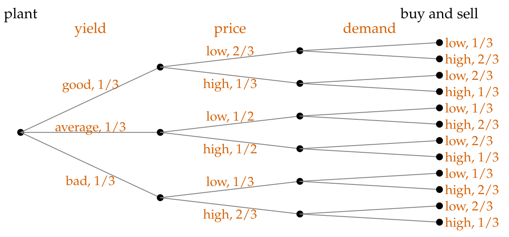

```{julia}
#| output: false
import Pkg
Pkg.activate(@__DIR__)
Pkg.instantiate()
```

```{julia}
#| output: false
using Plots
using Measures
using LaTeXStrings
using JuMP
using HiGHS

plot_font = "Palatino Roman"
default(
    fontfamily=plot_font,
    linewidth=3,
    framestyle=:box,
    label=nothing,
    grid=false,
    guidefontsize=18,
    legendfontsize=16,
    tickfontsize=16,
    titlefontsize=20,
    bottom_margin=10mm,
    left_margin=5mm
)

# Okabe-Ito palette: distinguishable under all common types of color
# blindness, and every pair also differs in line style so the figures
# still read in grayscale.
cb_orange = "#E69F00"
cb_green = "#009E73"
cb_yellow = "#F0E442"
cb_blue = "#0072B2"
cb_vermillion = "#D55E00"
cb_purple = "#CC79A7"
```

```{julia}
#| output: false

# The reservoir: storage in million m³, in whole millions from 0 to 4; start full.
# Each month: release r (at most what is stored), then that month's inflow
# arrives; anything above capacity spills.
capacity = 4                             # [million m³]
start_storage = 4
inflow = [1, 1, 0]                       # [million m³]: a three-month dry season
benefit_table = [0, 60, 100, 120, 130]   # [$1,000] for releasing 0, 1, 2, 3, 4 million m³
benefit(r) = benefit_table[r + 1]
next_storage(s, r, q) = min(s - r + q, capacity)
n_months = length(inflow)
levels = 0:capacity

# Greedy: release everything available every month
greedy_release = zeros(Int, n_months)
let s = start_storage
    for t in 1:n_months
        greedy_release[t] = s
        s = next_storage(s, s, inflow[t])
    end
end
greedy_total = sum(benefit.(greedy_release))

# The hand calculation, written out for months 3 and 2 only
# (the general function comes later and is checked against these)
value_month3 = zeros(Int, capacity + 1)
for s in levels
    value_month3[s + 1] = benefit(s)                  # last month: release everything
end
value_month2 = fill(-1, capacity + 1)
release_month2 = zeros(Int, capacity + 1)
for s in levels
    for r in 0:s
        total = benefit(r) + value_month3[next_storage(s, r, inflow[2]) + 1]
        if total > value_month2[s + 1]                # ties keep the smaller release
            value_month2[s + 1] = total
            release_month2[s + 1] = r
        end
    end
end

# Print whole numbers without a decimal point
function fmt(x)
    rounded_x = round(x; digits=2)
    if isinteger(rounded_x)
        return string(Int(rounded_x))
    end
    return string(rounded_x)
end
commas(n) = replace(string(round(Int, n)), r"(?<=\d)(?=(\d{3})+$)" => ",")
```

```{julia}
#| output: false

# Tables printed on the reservoir slides, with each step's arithmetic shown.
# The slides write the capacity, starting storage and inflows as numbers in
# their equations; stop if the data change under them.
@assert capacity == 4 && start_storage == 4 && inflow == [1, 1, 0]

# Follow a release sequence from a full reservoir, one row per month
function print_trace(releases, inflows)
    println("| Month \$t\$ | \$s_t\$ | \$r_t\$ | \$\\text{benefit}(r_t)\$ | \$s_{t+1}\$ |")
    println("|:--|--:|--:|--:|:--|")
    s = start_storage
    for t in eachindex(releases)
        r = releases[t]
        @assert 0 <= r <= s                       # a release can't exceed storage
        next_s = next_storage(s, r, inflows[t])
        println("| ", t, " | ", s, " | ", r, " | ", benefit(r), " | \$\\min(", s, " - ", r,
            " + ", inflows[t], ",\\ ", capacity, ") = ", next_s, "\$ |")
        s = next_s
    end
    return nothing
end

# Every allowed release from storage s in month t with a known inflow, and its
# total: benefit now plus V_{t+1} at the next storage. next_value[k] is
# V_{t+1} at storage k - 1. Returns the totals.
function print_options(s, t, inflow_t, next_value)
    println("| \$r\$ | \$\\text{benefit}(r)\$ | Next storage | \$V_{", t + 1,
        "}\$ there | Total |")
    println("|--:|--:|:--|--:|--:|")
    totals = zeros(s + 1)
    for r in 0:s
        next_s = next_storage(s, r, inflow_t)
        totals[r + 1] = benefit(r) + next_value[next_s + 1]
        println("| ", r, " | ", benefit(r), " | \$\\min(", s, " - ", r, " + ", inflow_t, ",\\ ",
            capacity, ") = ", next_s, "\$ | ", fmt(next_value[next_s + 1]), " | ",
            fmt(totals[r + 1]), " |")
    end
    return totals
end

# A table with one column per storage level and the given rows
function print_storage_table(row_labels, rows)
    println("| Storage \$s\$ | ", join(levels, " | "), " |")
    println("|:--|", repeat("--:|", capacity + 1))
    for k in eachindex(row_labels)
        println("| ", row_labels[k], " | ", join(fmt.(rows[k]), " | "), " |")
    end
    return nothing
end

# Releases that tie for the best total from storage s, as text
function tie_text(s, totals)
    best = maximum(totals)
    tied = [r for r in 0:s if totals[r + 1] == best]
    return "at storage $(s), releases $(join(tied, " and ")) both give $(fmt(best))"
end
```

```{julia}
#| output: false

# The farmer (Birge and Louveaux), from the two-stage example: wheat, corn and
# sugar beets on 500 acres, planted before the yield is known
land = 500                         # [acres]
plant_cost = [150, 230, 260]       # [$/acre]
avg_yield = [2.5, 3, 20]           # [T/acre] in an average year
feed_need = [200, 240]             # [T] of wheat and corn needed for feed
sell_price = [170, 150]            # [$/T] wheat and corn
buy_price = 1.4 .* sell_price      # buying costs 40% more than selling
beet_price = 36                    # [$/T] up to the quota
beet_quota = 6000                  # [T]
beet_excess_price = 10             # [$/T] above the quota
scenarios = ["Good", "Average", "Bad"]
yield_factor = [1.2, 1, 0.8]       # yields relative to average
prob = fill(1 / 3, 3)
# p_{b|a}: probability of year 2 yield b (column) after year 1 yield a (row)
persistence = [1/2 1/3 1/6; 1/3 1/3 1/3; 1/6 1/3 1/2]

# The two-stage farm model: one planting x, and purchases y and sales z for each
# scenario. Passing `plan` fixes the planting; `price_factors` scales the grain
# prices and `quotas` sets the beet demand in each scenario. Returns the
# planting and the expected profit.
function farm_model(factors, probs; plan=nothing, price_factors=ones(length(factors)),
        quotas=fill(beet_quota, length(factors)))
    n = length(factors)
    model = Model(HiGHS.Optimizer)
    set_silent(model)
    @variable(model, x[1:3] >= 0)
    @variable(model, y[1:2, 1:n] >= 0)
    @variable(model, z[1:4, 1:n] >= 0)
    if plan !== nothing
        @constraint(model, x .== plan)
    end
    @constraint(model, sum(x) <= land)
    for s in 1:n
        crop_yield = avg_yield .* factors[s]
        @constraint(model, crop_yield[1] * x[1] + y[1, s] - z[1, s] >= feed_need[1])
        @constraint(model, crop_yield[2] * x[2] + y[2, s] - z[2, s] >= feed_need[2])
        @constraint(model, z[3, s] + z[4, s] <= crop_yield[3] * x[3])
        @constraint(model, z[3, s] <= quotas[s])
    end
    @objective(model, Max, -sum(plant_cost .* x) + sum(probs[s] * (
        price_factors[s] * (sell_price[1] * z[1, s] + sell_price[2] * z[2, s] -
            buy_price[1] * y[1, s] - buy_price[2] * y[2, s]) +
        beet_price * z[3, s] + beet_excess_price * z[4, s])
        for s in 1:n))
    optimize!(model)
    return value.(x), objective_value(model)
end

# The two-stage plan, for one year with three equally likely year types
stochastic_plan, stochastic_profit = farm_model(yield_factor, prob)
```

# Review of Last Class

## Two-Stage Problems with Recourse

- The farmer plants wheat, corn and beets before the yield is known, then buys and sells once the harvest is in.
- Two-stage problems: **one** here-and-now decision, **one recourse decision per scenario**, weighted by probability.
- A **scenario tree** lays out the scenarios: each path from the root to a leaf is one.

## Questions?



# Scenario Trees

## Dependent Uncertainties in One Year

```{julia}
#| echo: false
#| output: false

# P(price | yield): rows good, average, bad; columns low, high (the tree figure)
price_given_yield = [2//3 1//3; 1//2 1//2; 1//3 2//3]
yield_prob = [1//3, 1//3, 1//3]
@assert all(sum(price_given_yield, dims=2) .== 1)
@assert yield_prob[3] * price_given_yield[3, 2] == 2//9
@assert sum(yield_prob .* price_given_yield[:, 2]) == 1//2
@assert price_given_yield[3, 2] == 2 * price_given_yield[1, 2]
# P(demand | price): rows price low, high; columns demand low, high
demand_given_price = [1//3 2//3; 2//3 1//3]
@assert all(sum(demand_given_price, dims=2) .== 1)
@assert yield_prob[3] * price_given_yield[3, 2] * demand_given_price[2, 1] == 4//27
@assert sum(yield_prob[y] * price_given_yield[y, p] * demand_given_price[p, d]
    for y in 1:3, p in 1:2, d in 1:2) == 1
```

{width=100% fig-alt="One-year scenario tree: planting, then the yield (good, average or bad, 1/3 each), then the grain price, low or high, with probabilities that depend on the yield (after a good yield low 2/3, high 1/3; average 1/2 each; bad low 1/3, high 2/3), then the demand for grain, low or high, with probabilities that depend on the price (after a low price low 1/3, high 2/3; after a high price low 2/3, high 1/3). Buying and selling happen after all three are known."}

::: {.notes}
Within one year the yield, the grain price and the demand are learned in turn, each depending on the one before. Nothing is decided in between, so there are still two stages: plant, then learn all three, then buy and sell. The probabilities are illustrative. If demand were a fixed function of the price, with no randomness of its own, it would add no branches: it would take a value at each leaf. The tree figures are drawn by `figures/scenario-trees.jl`.
:::

## Conditional Probabilities

A scenario's probability is the product of the conditional probabilities along its path, with outcomes in order (yield, price, demand):

$$
\begin{aligned}
P(\text{bad}, \text{high}, \text{low}) &= P(\text{bad})\, P(\text{high} \mid \text{bad})\, P(\text{low} \mid \text{high}) \\
&= 1/3 \times 2/3 \times 2/3 = 4/27
\end{aligned}
$$

## Prices in the Objective

```{julia}
#| echo: false
#| output: false

# The prices written on the slide
@assert sell_price == [170, 150] && buy_price ≈ [238, 210]
@assert beet_price == 36 && beet_excess_price == 10 && beet_quota == 6000
```

Each of the 12 scenarios has its own grain prices, so they change the objective, not only the constraints:

$$\max_{\mathbf{x}, \mathbf{y}, \mathbf{z}} \; -\mathbf{c}^\top \mathbf{x} + \sum_{s=1}^{12} p_s \big( \mathbf{q}_s^\top \mathbf{z}_s - \mathbf{w}_s^\top \mathbf{y}_s \big)$$

$\mathbf{c}$ is the planting cost per acre, and $p_s$ the scenario's probability from the tree.

## Scenario Prices and Demand

- Sale prices $\mathbf{q}_s = (170 g_s,\ 150 g_s,\ 36,\ 10)$ (wheat, corn, beets up to the demand, beets above it); purchase prices $\mathbf{w}_s = (238 g_s,\ 210 g_s)$.
- $g_s = 0.9$ for a low grain price, $1.1$ for a high one; beet prices are set by contract.
- The beet demand $D_s$, 5,000 or 7,000 T, replaces the 6,000 T quota in the constraints.

## Solving the More Complex Problem

```{julia}
#| echo: true
#| code-fold: true
#| output: asis

# The 12 scenarios of the one-year tree: yield factor, grain price factor, beet
# demand, and probability (the product along the path)
price_level = [0.9, 1.1]              # g: low or high grain price
beet_demand = [5000, 7000]            # D [T]: low or high
n_scenarios = 12
scenario_yield = zeros(n_scenarios)
scenario_price = zeros(n_scenarios)
scenario_demand = zeros(n_scenarios)
scenario_prob = zeros(n_scenarios)
let k = 0
    for y in 1:3, p in 1:2, d in 1:2
        k = k + 1
        scenario_yield[k] = yield_factor[y]
        scenario_price[k] = price_level[p]
        scenario_demand[k] = beet_demand[d]
        scenario_prob[k] = yield_prob[y] * price_given_yield[y, p] * demand_given_price[p, d]
    end
end
one_year_plan, one_year_profit = farm_model(scenario_yield, scenario_prob;
    price_factors=scenario_price, quotas=scenario_demand)

println("| Scenarios | Wheat | Corn | Beets |")
println("|:--|--:|--:|--:|")
println("| 3: yield only | ", join(fmt.(stochastic_plan), " | "), " |")
println("| 12: yield, price, demand | ", join(fmt.(one_year_plan), " | "), " |")
```

```{julia}
#| echo: false
#| output: false

@assert isapprox(sum(scenario_prob), 1)
# more beets, less wheat, the same corn; the beets fill the high demand in a good year
@assert one_year_plan[3] > stochastic_plan[3] && one_year_plan[1] < stochastic_plan[1]
@assert isapprox(one_year_plan[2], stochastic_plan[2]; atol=1e-6)
beets_good_year = one_year_plan[3] * avg_yield[3] * yield_factor[1]
@assert isapprox(beets_good_year, beet_demand[2]; atol=1e-6)
# the 3-scenario plan, evaluated in the 12 scenarios
old_plan_profit_12 = farm_model(scenario_yield, scenario_prob; plan=stochastic_plan,
    price_factors=scenario_price, quotas=scenario_demand)[2]
plan_gain = one_year_profit - old_plan_profit_12
@assert plan_gain > 0
```

Good harvests make low grain prices and high beet demand more likely, so we plant more beets.

::: {.notes}
In the 12 scenarios, this plan expects \$`{julia} commas(one_year_profit)` and the 3-scenario plan \$`{julia} commas(old_plan_profit_12)`. Wheat gives up the land: corn stays at the acreage that covers the feed.
:::

## Multi-Stage Decisions

Suppose that weather patterns have **memory** from year to year: growing conditions in Year 2 are influenced by Year 1's conditions.

{width=100% fig-alt="Scenario tree over two years: planting, three year 1 yields with probability 1/3 each, a node for each with buying, selling and the year 2 planting, then three year 2 yields whose probabilities depend on year 1: after a good year, good 1/2, average 1/3, bad 1/6; after an average year, 1/3 each; after a bad year, good 1/6, average 1/3, bad 1/2."}

::: {.notes}
Year 2 repeats year 1's problem, with nothing physical carried over. Each year on its own is still good, average or bad with probability 1/3; only the joint probabilities change.
:::


## Two-Year Decision Variables

Let $a$ be year 1's yield and $b$ year 2's, each G, A or B (good, average, bad); bold symbols are vectors. **Which yields can each decision depend on?**

::: {.fragment .fade-in}
- $\mathbf{x}^{(1)}$: year 1 planting, before any yield is known
- $\mathbf{y}^{(1)}_a$, $\mathbf{z}^{(1)}_a$: year 1 purchases and sales, after year 1's yield
- $\mathbf{x}^{(2)}_a$: year 2 planting, after year 1's yield but before year 2's
- $\mathbf{y}^{(2)}_{ab}$, $\mathbf{z}^{(2)}_{ab}$: year 2 purchases and sales, after both
:::

::: {.notes}
Each variable is indexed by the yields known when it is decided, so the subscripts match the nodes of the tree: one year 1 planting, three sets of year 1 purchases and sales, three year 2 plantings, and nine sets of year 2 purchases and sales.
:::

## Profit Maximization Over Both Years

$$
\begin{aligned}
\max_{\mathbf{x}, \mathbf{y}, \mathbf{z}} \quad & -\mathbf{c}^\top \mathbf{x}^{(1)} + \sum_a p_a \Big[ \mathbf{q}^\top \mathbf{z}^{(1)}_a - \mathbf{w}^\top \mathbf{y}^{(1)}_a - \mathbf{c}^\top \mathbf{x}^{(2)}_a \\
& \qquad + \sum_b p_{b \mid a} \big( \mathbf{q}^\top \mathbf{z}^{(2)}_{ab} - \mathbf{w}^\top \mathbf{y}^{(2)}_{ab} \big) \Big]
\end{aligned}
$$

$\mathbf{c}$ the planting costs per acre, $\mathbf{q}$ the sale prices, $\mathbf{w}$ the purchase prices, $p_a = \tfrac{1}{3}$, and $p_{b \mid a}$ the probability of year 2 yield $b$ after $a$.

::: {.notes}
$\mathbf{q}$ has four entries (wheat, corn, beets up to the quota, beets above it) and $\mathbf{w}$ two (wheat, corn).
:::

## Constraints

```{julia}
#| echo: false
#| output: false

# The numbers written in the equations below
@assert land == 500 && avg_yield[1] == 2.5 && feed_need[1] == 200 && yield_factor == [1.2, 1, 0.8]
```

Constraints for each scenario include that year's planting and yield factor ($\phi_G = 1.2$, $\phi_A = 1$, $\phi_B = 0.8$). On a path $ab$, for example:

$$
\begin{aligned}
x^{(2)}_{\text{wheat},a} + x^{(2)}_{\text{corn},a} + x^{(2)}_{\text{beets},a} &\leq 500 && \text{(land)} \\
2.5\,\phi_b\, x^{(2)}_{\text{wheat},a} + y^{(2)}_{\text{wheat},ab} - z^{(2)}_{\text{wheat},ab} &\geq 200 && \text{(wheat for feed)}
\end{aligned}
$$

## Year 2 Planting Decisions

```{julia}
#| echo: true
#| code-fold: true
#| output: asis

# No decision links the years, so the year 2 planting after year 1 yield a
# solves the two-stage problem with probabilities p_{b|a} (row a of persistence)
year2_plan = zeros(3, 3)
year2_profit = zeros(3)
for a in 1:3
    year2_plan[a, :], year2_profit[a] = farm_model(yield_factor, persistence[a, :])
end
println("| Year 1 yield | Wheat (acres) | Corn (acres) | Beets (acres) |")
println("|:--|--:|--:|--:|")
for a in 1:3
    println("| ", scenarios[a], " | ", join(fmt.(year2_plan[a, :]), " | "), " |")
end
```

```{julia}
#| echo: false
#| output: false

# Check: the full two-year model (a planting at each node of the tree) gives
# last class's plan in year 1 and the table's plantings in year 2
function sales_minus_purchases(y, z)    # q'z - w'y
    sales = sell_price[1] * z[1] + sell_price[2] * z[2] +
        beet_price * z[3] + beet_excess_price * z[4]
    return sales - buy_price[1] * y[1] - buy_price[2] * y[2]
end
function add_year_constraints!(model, x, y, z, phi)
    crop_yield = avg_yield .* phi
    @constraint(model, crop_yield[1] * x[1] + y[1] - z[1] >= feed_need[1])
    @constraint(model, crop_yield[2] * x[2] + y[2] - z[2] >= feed_need[2])
    @constraint(model, z[3] + z[4] <= crop_yield[3] * x[3])
    @constraint(model, z[3] <= beet_quota)
end
two_year = Model(HiGHS.Optimizer)
set_silent(two_year)
@variables(two_year, begin
    x1[1:3] >= 0
    y1[1:2, a in 1:3] >= 0
    z1[1:4, a in 1:3] >= 0
    x2[1:3, a in 1:3] >= 0
    y2[1:2, a in 1:3, b in 1:3] >= 0
    z2[1:4, a in 1:3, b in 1:3] >= 0
end)
@objective(two_year, Max, -sum(plant_cost .* x1) + sum(prob[a] * (
    sales_minus_purchases(y1[:, a], z1[:, a]) - sum(plant_cost .* x2[:, a]) +
    sum(persistence[a, b] * sales_minus_purchases(y2[:, a, b], z2[:, a, b])
        for b in 1:3))
    for a in 1:3))
@constraint(two_year, sum(x1) <= land)
for a in 1:3
    add_year_constraints!(two_year, x1, y1[:, a], z1[:, a], yield_factor[a])
    @constraint(two_year, sum(x2[:, a]) <= land)
    for b in 1:3
        add_year_constraints!(two_year, x2[:, a], y2[:, a, b], z2[:, a, b], yield_factor[b])
    end
end
optimize!(two_year)
@assert is_solved_and_feasible(two_year)
@assert isapprox(value.(x1), stochastic_plan; atol=1e-6)
for a in 1:3
    @assert isapprox(value.(x2[:, a]), year2_plan[a, :]; atol=1e-6)
end
@assert isapprox(objective_value(two_year), stochastic_profit + sum(prob .* year2_profit); atol=1e-3)

# The probabilities on the tree and the earlier slides
for i in 1:3
    @assert isapprox(sum(persistence[i, :]), 1) && isapprox(sum(persistence[:, i]), 1)
end
@assert persistence[3, 3] == 1 / 2 && persistence[1, 3] == 1 / 6
# After a good or an average year the planting is unchanged; after a bad year the
# wheat and corn just cover the feed in another bad year
for i in 1:2
    @assert isapprox(year2_plan[i, :], stochastic_plan; atol=1e-6)
end
@assert isapprox(year2_plan[3, 1] * avg_yield[1] * yield_factor[3], feed_need[1]; atol=1e-6)
@assert isapprox(year2_plan[3, 2] * avg_yield[2] * yield_factor[3], feed_need[2]; atol=1e-6)
```

Each row solves the two-stage problem for $p_{b \mid a}$. After a bad year, we plant more beets because the probability of a good yield is lower.

::: {.notes}
The expected year 2 profit is \$`{julia} commas(year2_profit[1])` after a good year, \$`{julia} commas(year2_profit[2])` after an average one and \$`{julia} commas(year2_profit[3])` after a bad one. After a bad year the plan grows `{julia} fmt(year2_plan[3, 1])` acres of wheat and `{julia} fmt(year2_plan[3, 2])` of corn, just enough for the feed in a bad year, and `{julia} fmt(year2_plan[3, 3])` of beets.
:::

## Scenario Trees Grow Fast

```{julia}
#| echo: false
#| output: asis

# With three yield outcomes a year: 3^T leaves after T years, and
# 1 + 3 + ... + 3^T nodes, each with its own copy of the decisions made there
println("| Years \$T\$ | Scenarios (leaves) \$3^T\$ | Nodes \$1 + 3 + \\cdots + 3^T\$ |")
println("|:--|--:|--:|")
for n_years in [1, 2, 3, 10]
    n_nodes = 0
    for t in 0:n_years
        n_nodes = n_nodes + 3^t
    end
    println("| ", n_years, " | ", commas(3^n_years), " | ", commas(n_nodes), " |")
end
```

This is an example of the **curse of dimensionality**: new "levels" increase the number of scenarios exponentially.


# Dynamic Programming

## Decisions Linked Over Time

Often a decision at time $t$ changes the initial state for time $t+1$:

- **Reservoir**: water stored for next year influences potential release levels and flooding probabilities.
- **Fishery**: this season's harvest changes next season's stock.

The "benefits" (or costs) of each state are also typically nonlinear (*e.g.* diminishing returns).

## Reservoir Management

- Storage holds up to **`{julia} capacity` million m³** and starts **full**: $s_1 = 4$.
- Each month $t$: **release** $r_t \in \{0, 1, \ldots, s_t\}$, then the **inflow** $I_t$ arrives: $I_1 = 1$, $I_2 = 1$, $I_3 = 0$ million m³.
- Anything above `{julia} capacity` spills: $s_{t+1} = \min(s_t - r_t + I_t,\ 4)$.
- **Goal**: maximize $\sum_t \text{benefit}(r_t)$; leftover water is worthless.

```{julia}
#| echo: false
#| output: asis

println("| Release \$r\$ [million m³] | ", join(0:capacity, " | "), " |")
println("|:--|", repeat("--:|", capacity + 1))
println("| \$\\text{benefit}(r)\$ [\\\$1,000] | ", join(benefit_table, " | "), " |")
```

::: {.notes}
Think of a small irrigation reservoir in a dry season. The benefits have diminishing returns as water moves from high-value to low-value crops: the first million m³ released in a month adds \$60,000 (\$60 per 1,000 m³, about \$74 an acre-foot), the second \$40,000, the third \$20,000 and the fourth \$10,000 (about \$12 an acre-foot). These are illustrative but in the range of US irrigation water values, which run from a few dollars an acre-foot for low-value crops to hundreds for vegetables (National Research Council; USDA ERS). Storage in steps of 1 million m³ and releasing before the inflow arrives are modeling conventions.
:::

## The Greedy Plan

In a **greedy** plan, each decision maximizes only its own stage's benefit with no forward planning.

```{julia}
#| echo: false
#| output: asis

print_trace(greedy_release, inflow)
```

Total (\$1,000): `{julia} join(benefit.(greedy_release), " + ")` = `{julia} greedy_total`.

## Spreading the Releases

```{julia}
#| echo: false
#| output: false

spread_release = fill(2, n_months)
spread_total = sum(benefit.(spread_release))
@assert spread_total > greedy_total
```

Releasing 2 million m³ a month keeps water for later months:

```{julia}
#| echo: false
#| output: asis

print_trace(spread_release, inflow)
```

Total (\$1,000): `{julia} join(benefit.(spread_release), " + ")` = **`{julia} spread_total`** (greedy: `{julia} greedy_total`).

::: {.notes}
Trial and error does not scale: more months, more storage levels or uncertain inflows quickly make it impossible to try every plan.
:::

## Elements of a Dynamic Program

- **Stage** $t = 1, \ldots, T$.
- **State** $s_t$.
- **Decision** $x_t \in \mathcal{X}_t(s_t)$.

## Inputs, Transitions, and Benefits

- **Input** $\xi_t$: exogenous changes to the post-decision state.
- **Transition** $s_{t+1} = f_t(s_t, x_t, \xi_t)$.
- **Benefit** $\text{benefit}_t(s_t, x_t)$: the utility of each decision.

## The Value Function

- **Terminal value** $V_{T+1}(s)$: value of ending with a particular state.
- **Value function**: $V_t(s) = \max_{x_t, \ldots, x_T} \big[\sum_{k=t}^{T} \text{benefit}_k(s_k, x_k) + V_{T+1}(s_{T+1})\big]$ with $s_t = s$, $x_k \in \mathcal{X}_k(s_k)$, $s_{k+1} = f_k(s_k, x_k, \xi_k)$: the best total benefit from stage $t$ on.
- **Policy**: a rule giving a decision for every stage $t$ and state $s$. The **optimal policy** $x^*_t(s)$ earns $V_t(s)$ from each.

::: {.notes}
The value function is the key idea: it answers "how good is it to be here?" for every state, not only the one we start in. Once we know the next stage's value function, choosing this stage's decision is a one-step problem.
:::

## The Bellman Equation

With known inputs, the optimal policy $x^*_t(s)$ maximizes this stage's benefit plus $V_{t+1}$ at the next state:

$$\begin{aligned}
V_t(s) &= \max_{x \in \mathcal{X}_t(s)} \Big[ \text{benefit}_t(s, x) + V_{t+1}\big(f_t(s, x, \xi_t)\big) \Big] \\
x^*_t(s) &= \argmax_{x \in \mathcal{X}_t(s)} \Big[ \text{benefit}_t(s, x) + V_{t+1}\big(f_t(s, x, \xi_t)\big) \Big]
\end{aligned}$$

**Backward induction**: start from the terminal value $V_{T+1}$, solve for $V_T$, then $V_{T-1}$, and so on back to $V_1$.

::: {.notes}
Here the inputs are known; with uncertain inputs we will average $V_{t+1}$ over them.
:::

## Backward Induction for the Reservoir

```{julia}
#| echo: true
#| code-fold: true
#| eval: false

# The reservoir in code (defined once, at the top of the deck)
capacity = 4                          # largest storage [million m³]
inflow = [1, 1, 0]                    # I_1, I_2, I_3
benefit_table = [0, 60, 100, 120, 130]  # [$1,000] for releasing 0, ..., 4
benefit(r) = benefit_table[r + 1]     # Julia arrays start at 1
next_storage(s, r, q) = min(s - r + q, capacity)   # s_{t+1}
n_months = length(inflow)
levels = 0:capacity                   # storage levels
```

With no carryover value, $V_4(s) = 0$, and for each month $t = 3, 2, 1$ and storage $s \in \{0, 1, \ldots, 4\}$:

$$V_t(s) = \max_{r \in \{0, 1, \ldots, s\}} \Big[ \text{benefit}(r) + V_{t+1}\big(\min(s - r + I_t,\ 4)\big) \Big]$$

In month 3, $V_4 = 0$ and the benefit increases with $r$, so month 3 releases everything: $V_3(s) = \text{benefit}(s)$.

::: {.notes}
The last stage is the easy one, because no later month depends on it. That is why we start there.
:::

## Month 2 by Hand

```{julia}
#| echo: false
#| output: false

# The worked example: storage 3 in month 2 with release 1, then the other releases
example_s = 3
example_r = 1
example_next = next_storage(example_s, example_r, inflow[2])
example_total = benefit(example_r) + value_month3[example_next + 1]
example_totals = [benefit(r) + value_month3[next_storage(example_s, r, inflow[2]) + 1]
    for r in 0:example_s]
# the numbers written in the equations on the slide
@assert inflow[2] == 1 && example_next == 3 && benefit(1) == 60
@assert value_month3[example_next + 1] == benefit(3) == 120 && example_total == 180
@assert maximum(example_totals) == value_month2[example_s + 1]
@assert argmax(example_totals) - 1 == release_month2[example_s + 1]
```

$$V_2(s) = \max_{r \in \{0, 1, \ldots, s\}} \Big[ \text{benefit}(r) + V_3\big(\min(s - r + 1,\ 4)\big) \Big]$$

For example, from $s = 3$ with $r = 1$ (and $I_2 = 1$):

$$
\begin{aligned}
\text{next storage} &= \min(3 - 1 + 1,\ 4) = 3 \\
\text{benefit}(1) + V_3(3) &= 60 + \text{benefit}(3) = 60 + 120 = 180
\end{aligned}
$$

Releases 0, 2, 3 give `{julia} example_totals[1]`, `{julia} example_totals[3]`, `{julia} example_totals[4]`: $V_2(3) =$ **`{julia} value_month2[example_s + 1]`**, at $r =$ `{julia} release_month2[example_s + 1]`.

::: {.notes}
Board item. Work $r = 1$ together on the board, then let students try $r = 0$ and $r = 2$. Totals are in \$1,000.
:::

## Month 2: Every Storage Level

The same calculation for each storage level:

```{julia}
#| echo: false
#| output: asis

print_storage_table(["Best release \$r\$", "\$V_2(s)\$"], [release_month2, value_month2])
```

```{julia}
#| echo: false
#| output: asis

# Storage levels where two releases tie in month 2
month2_totals = [[benefit(r) + value_month3[next_storage(s, r, inflow[2]) + 1] for r in 0:s]
    for s in levels]
tied_levels = [s for s in levels if count(==(maximum(month2_totals[s + 1])), month2_totals[s + 1]) > 1]
tie_sentences = [tie_text(s, month2_totals[s + 1]) for s in tied_levels]
@assert tied_levels == [2, 4]
println(uppercasefirst(join(tie_sentences, "; ")), ".")
```

## Backward Induction in Code

```{julia}
#| echo: true
#| code-fold: false
#| output: false

function backward_induction(inflow; carryover_value=0)
    value_table = fill(-Inf, capacity + 1, n_months + 1)  # V_t(s) in row s + 1
    policy_table = zeros(Int, capacity + 1, n_months)     # best release
    value_table[:, n_months + 1] = carryover_value .* levels  # V_4(s)
    for t in n_months:-1:1, s in levels       # months backwards, every storage
        for r in 0:s                          # every allowed release
            next_s = next_storage(s, r, inflow[t])
            total = benefit(r) + value_table[next_s + 1, t + 1]
            if total > value_table[s + 1, t]  # ties keep the smaller release
                value_table[s + 1, t] = total
                policy_table[s + 1, t] = r
            end
        end
    end
    return value_table, policy_table
end
```

::: {.notes}
Storage $s$ is in row $s + 1$ of each table, because Julia arrays start at 1. The code is the hand calculation in a loop: months backwards, every storage level, every allowed release, each one an option in the Bellman equation. Both tables are allocated at full size before the loop. A release replaces the best so far only if it is strictly better, so ties keep the smaller release, as in the month 2 table.
:::

## Month 1 with Storage 4

```{julia}
#| echo: false
#| output: false

value_table, policy_table = backward_induction(inflow)

# The function reproduces the hand calculation
@assert value_table[:, 3] == value_month3
@assert value_table[:, 2] == value_month2
@assert policy_table[:, 2] == release_month2

# Follow the policy forward from a full reservoir: the plan
dp_release = zeros(Int, n_months)
let s = start_storage
    for t in 1:n_months
        dp_release[t] = policy_table[s + 1, t]
        s = next_storage(s, dp_release[t], inflow[t])
    end
end
dp_total = sum(benefit.(dp_release))
@assert dp_total == value_table[start_storage + 1, 1]
@assert dp_release == spread_release
```

```{julia}
#| echo: false
#| output: asis

totals_month1_s4 = print_options(start_storage, 1, inflow[1], value_table[:, 2])
@assert maximum(totals_month1_s4) == value_table[start_storage + 1, 1]
@assert argmax(totals_month1_s4) - 1 == policy_table[start_storage + 1, 1]
```

Best: release **`{julia} policy_table[start_storage + 1, 1]`**, so $V_1(4) =$ **`{julia} fmt(value_table[start_storage + 1, 1])`**.

## The Optimal Policy

Repeating this for every month and storage:

```{julia}
#| echo: false
#| output: asis

print_storage_table(["Month $(t): best release" for t in 1:n_months],
    [policy_table[:, t] for t in 1:n_months])
```

```{julia}
#| echo: false
#| output: asis

# Ties in months 1 and 2 (month 3 always releases everything)
function tie_list(value_table, t)
    tied = [s for s in levels if count(==(maximum([benefit(r) +
        value_table[next_storage(s, r, inflow[t]) + 1, t + 1] for r in 0:s])),
        [benefit(r) + value_table[next_storage(s, r, inflow[t]) + 1, t + 1] for r in 0:s]) > 1]
    return tied
end
ties_month1 = tie_list(value_table, 1)
ties_month2 = tie_list(value_table, 2)
@assert ties_month1 == [2, 3] && ties_month2 == [2, 4]
println("Tied cells (month 1 at storages ", join(ties_month1, " and "), ", month 2 at ",
    join(ties_month2, " and "), ") show the smaller release.")
```

## From Policy to Plan

Following the optimal policy from $s_1 = 4$ gives the plan:

```{julia}
#| echo: false
#| output: asis

print_trace(dp_release, inflow)
```

Total (\$1,000): `{julia} join(benefit.(dp_release), " + ")` = `{julia} dp_total` $= V_1(4)$: the spread plan is optimal, as the appendix checks against every release sequence.

::: {.notes}
To get the plan, start from $s_1 = 4$, look up the policy's release, compute the next storage, and repeat.
:::


# Uncertain Inflows

## Decisions With Uncertain Inflows

Now each month's inflow is **0 (dry) or 2 (wet) million m³**, each with probability $\tfrac{1}{2}$, independent across months and unknown at the release. $V_t(s)$ is the best **expected** total benefit over policies:

$$V_t(s) = \max_{x \in \mathcal{X}_t(s)} \Big\{ \text{benefit}_t(s, x) + \mathbb{E}_{\xi_t}\Big[ V_{t+1}\big(f_t(s, x, \xi_t)\big) \Big] \Big\}$$

$\mathbb{E}_{\xi_t}$ averages over the outcomes of $\xi_t$; this needs their probabilities not to depend on earlier inputs.

## The Reservoir With Uncertain Inflows

For each month $t = 3, 2, 1$ and storage $s \in \{0, 1, \ldots, 4\}$, with $V_4(s) = 0$:

$$
\begin{aligned}
V_t(s) = \max_{r \in \{0, 1, \ldots, s\}} \Big[\, \text{benefit}(r) &+ \tfrac{1}{2} V_{t+1}(s - r) \\
&+ \tfrac{1}{2} V_{t+1}\big(\min(s - r + 2,\ 4)\big) \Big]
\end{aligned}
$$

The first $\tfrac{1}{2}$ term is for a dry month, the second for a wet one.

::: {.notes}
The only change from known inflows is the average of $V_{t+1}$ over the two next storages. With inflow 0 the next storage is $s - r$, which is never above 4. Every month's inflow now averages 1, including month 3, so this is a different season from the dry one; month 3's inflow arrives after the last release and doesn't matter.
:::

## Solving With Uncertain Inflows

```{julia}
#| echo: true
#| code-fold: true
#| output: false

inflow_outcomes = [0, 2]              # each month: dry or wet
inflow_probs = [0.5, 0.5]

function backward_induction_uncertain(; carryover_value=0)
    value_table = fill(-Inf, capacity + 1, n_months + 1)  # expected V_t(s)
    policy_table = zeros(Int, capacity + 1, n_months)
    value_table[:, n_months + 1] = carryover_value .* levels
    for t in n_months:-1:1, s in levels
        for r in 0:s
            # the only change from known inflows: the expected V_{t+1}
            expected_next = 0
            for k in eachindex(inflow_outcomes)
                next_s = next_storage(s, r, inflow_outcomes[k])
                expected_next = expected_next +
                    inflow_probs[k] * value_table[next_s + 1, t + 1]
            end
            total = benefit(r) + expected_next
            if total > value_table[s + 1, t]  # ties keep the smaller release
                value_table[s + 1, t] = total
                policy_table[s + 1, t] = r
            end
        end
    end
    return value_table, policy_table
end

uncertain_value_table, uncertain_policy_table = backward_induction_uncertain()
```

```{julia}
#| echo: false
#| output: asis

print_storage_table(
    ["\$V_3(s)\$", "Month 2: best release", "\$V_2(s)\$",
        "Month 1: best release", "\$V_1(s)\$"],
    [uncertain_value_table[:, 3],
        uncertain_policy_table[:, 2], uncertain_value_table[:, 2],
        uncertain_policy_table[:, 1], uncertain_value_table[:, 1]])
```

```{julia}
#| echo: false
#| output: false

@assert uncertain_value_table[:, 3] == value_month3 && uncertain_policy_table[:, 3] == collect(levels)
```

::: {.notes}
Month 3 releases everything, as before; months 2 and 1 average over the two inflows. In month 2 at storage 2, releases 1 and 2 tie (15); the table reports the smaller.
:::

## Month 1 With Uncertain Inflows

From $s = 4$: $s_\text{dry} = 4 - r$ and $s_\text{wet} = \min(4 - r + 2,\ 4)$.

```{julia}
#| echo: false
#| output: asis

@assert inflow_outcomes == [0, 2] && inflow_probs == [0.5, 0.5]
next_value = uncertain_value_table[:, 2]
println("| \$r\$ | \$\\text{benefit}(r)\$ | \$s_\\text{dry}, s_\\text{wet}\$ | \$\\tfrac{1}{2} V_2(s_\\text{dry}) + \\tfrac{1}{2} V_2(s_\\text{wet})\$ | Total |")
println("|--:|--:|:--|:--|--:|")
uncertain_totals = zeros(start_storage + 1)
uncertain_expected = zeros(start_storage + 1)
for r in 0:start_storage
    dry_s = next_storage(start_storage, r, 0)
    wet_s = next_storage(start_storage, r, 2)
    uncertain_expected[r + 1] = 0.5 * next_value[dry_s + 1] + 0.5 * next_value[wet_s + 1]
    uncertain_totals[r + 1] = benefit(r) + uncertain_expected[r + 1]
end
for r in 0:start_storage
    dry_s = next_storage(start_storage, r, 0)
    wet_s = next_storage(start_storage, r, 2)
    is_best = uncertain_totals[r + 1] == maximum(uncertain_totals)
    total_text = is_best ? "**" * fmt(uncertain_totals[r + 1]) * "**" : fmt(uncertain_totals[r + 1])
    println("| ", r, " | ", benefit(r), " | ", dry_s, ", ", wet_s, " | \$\\tfrac{1}{2}(",
        fmt(next_value[dry_s + 1]), ") + \\tfrac{1}{2}(", fmt(next_value[wet_s + 1]), ") = ",
        fmt(uncertain_expected[r + 1]), "\$ | ", total_text, " |")
end
best_uncertain_release = argmax(uncertain_totals) - 1
@assert best_uncertain_release == uncertain_policy_table[start_storage + 1, 1]
@assert maximum(uncertain_totals) == uncertain_value_table[start_storage + 1, 1]
```


## The Policy With Uncertain Inflows

```{julia}
#| echo: false
#| output: false

# Releasing everything every month, from storage s in month t: expected total
function release_all_expected(s, t)
    if t > n_months
        return 0
    end
    expected_next = 0
    for k in eachindex(inflow_outcomes)
        next_s = next_storage(s, s, inflow_outcomes[k])
        expected_next = expected_next + inflow_probs[k] * release_all_expected(next_s, t + 1)
    end
    return benefit(s) + expected_next
end
release_all_value = release_all_expected(start_storage, 1)

# The best total if every inflow were known to be the mean
mean_inflow = sum(inflow_probs .* inflow_outcomes)
@assert isinteger(mean_inflow)        # storage levels are whole millions of m³
known_mean_values, known_mean_policy = backward_induction(fill(Int(mean_inflow), n_months))
known_mean_value = known_mean_values[start_storage + 1, 1]

uncertain_value = uncertain_value_table[start_storage + 1, 1]
first_release = uncertain_policy_table[start_storage + 1, 1]
@assert first_release == known_mean_policy[start_storage + 1, 1]   # the notes' claim
@assert release_all_value < uncertain_value
# Month 2 at storage 2 ties, so the evidence that releases follow the inflows is
# month 3: its release after each of the four inflow histories
month2_tie = [benefit(r) + 0.5 * uncertain_value_table[next_storage(2, r, 0) + 1, 3] +
    0.5 * uncertain_value_table[next_storage(2, r, 2) + 1, 3] for r in 0:2]
@assert month2_tie[2] == month2_tie[3] == maximum(month2_tie)
month3_release = zeros(Int, 4)
histories = [(0, 0), (0, 2), (2, 0), (2, 2)]
for h in 1:4
    s1 = start_storage
    s2 = next_storage(s1, uncertain_policy_table[s1 + 1, 1], histories[h][1])
    s3 = next_storage(s2, uncertain_policy_table[s2 + 1, 2], histories[h][2])
    month3_release[h] = uncertain_policy_table[s3 + 1, 3]
end
@assert length(unique(month3_release)) == 4
# Perfect information: the best total for each inflow sequence, averaged
sequences = vec(collect(Iterators.product(inflow_outcomes, inflow_outcomes, inflow_outcomes)))
perfect_totals = zeros(length(sequences))
for k in eachindex(sequences)
    values_k, _ = backward_induction(collect(sequences[k]))
    perfect_totals[k] = values_k[start_storage + 1, 1]
end
perfect_info_value = sum(perfect_totals) / length(sequences)
evpi = perfect_info_value - uncertain_value
@assert perfect_info_value == 290 && evpi == 7.5
```

- From a full reservoir, the optimal policy releases **`{julia} first_release` million m³** in month 1.
- Later releases depend on the inflows so far, so the answer is a policy, not a single plan: month 3 releases `{julia} join(month3_release, ", ")` after inflows (0, 0), (0, 2), (2, 0) and (2, 2).
- Expected total benefit: **`{julia} fmt(uncertain_value)`** (\$1,000). With perfect information about the inflows it would be `{julia} fmt(perfect_info_value)`, so the EVPI is `{julia} fmt(evpi)`. The greedy policy's expected total is `{julia} fmt(release_all_value)`.

::: {.notes}
The optimal policy releases 2 million m³ from a full reservoir, as it would with inflows known to be 1 million m³ every month: here uncertainty doesn't change that release, and the policy holds water back because of diminishing returns. Don't compare 28.25 with the best total for inflows fixed at their mean (`{julia} fmt(known_mean_value)`): a value in the average scenario isn't an expected value. Month 2 isn't the evidence for a policy because at storage 2 releases 1 and 2 tie; month 3's releases vary with the inflows under either tie rule (1, 3, 2, 4 here; 0, 2, 2, 4 if ties took the larger release). Releasing everything every month gives up `{julia} fmt(uncertain_value - release_all_value)` in expectation; its 23 equals the $r = 4$ row of the previous table because, after releasing 4, releasing everything is also optimal (month 2 ties at storage 2).
:::

## Reservoir States as a Scenario Tree

```{julia}
#| echo: true
#| code-fold: true
#| output: false

# The scenario-tree method: the best expected total from storage s in month t,
# trying every release at every node of the tree (no table)
function tree_value(s, t)
    if t > n_months
        return 0
    end
    best = -Inf
    for r in 0:s
        best = max(best, tree_total(s, r, t))
    end
    return best
end

# Release r's benefit plus the expected best total at the next nodes
function tree_total(s, r, t)
    expected = 0
    for k in eachindex(inflow_outcomes)
        next_s = next_storage(s, r, inflow_outcomes[k])
        expected = expected + inflow_probs[k] * tree_value(next_s, t + 1)
    end
    return benefit(r) + expected
end

# The best release at a node (ties keep the smaller release)
function tree_best_release(s, t)
    best_r = 0
    for r in 1:s
        if tree_total(s, r, t) > tree_total(s, best_r, t)
            best_r = r
        end
    end
    return best_r
end

tree_best = tree_value(start_storage, 1)
```

- The month 1 release is the **here-and-now** decision. Each later release is **recourse** for the inflows so far and here-and-now for its own month's inflow.
- The tree has a decision node for each inflow history: $1 + 2 + 4 = 7$ over three months.
- As in the farmer's tree, each node gets its own release. The code solves the Bellman equation separately at every node, with no table.

::: {.notes}
The same tree can be solved as one JuMP model, with a release variable per node, like the farmer's two-year model.
:::

## Trees Versus Tables

```{julia}
#| echo: false
#| output: asis

n_outcomes = length(inflow_outcomes)
n_levels = capacity + 1
println("| Months \$T\$ | Tree decision nodes \$2^T - 1\$ | Table entries \$", n_levels, "T\$ |")
println("|:--|--:|--:|")
for T in [3, 4, 5, 12]
    println("| ", T, " | ", commas(n_outcomes^T - 1), " | ", n_levels * T, " |")
end
# the first horizon at which the table is smaller than the tree
first_smaller = findfirst(T -> n_levels * T < n_outcomes^T - 1, 1:20)
@assert first_smaller == 5
```

Each tree node and each table entry is one release to choose. Tree: $1 + 2 + \cdots + 2^{T-1} = 2^T - 1$, exponential in $T$; table: $5T$, linear. From `{julia} first_smaller` months on, the table is smaller.

::: {.notes}
The tree records every possible history; the table records only the states that matter for the future. The appendix shows that the table grows exponentially with the number of state variables instead: the curse of dimensionality.
:::

# Key Takeaways

## Key Takeaways (Scenario Trees)

- Each **node** holds the decisions made there; a scenario's probability is the product of its conditional branch probabilities.
- A branch's probability can depend on earlier branches, in the same stage (prices on the yield) or in earlier stages (**memory**). Without memory, the tree after every decision in a stage is the same.
- **Scenario trees grow multiplicatively** with every stage that has its own decision and uncertainty.

## Key Takeaways (DP)

- A dynamic program has stages, states, decisions, inputs, a transition and a benefit. Greedy decisions can lower the total benefit.
- **Backward induction** solves the **Bellman equation** from the last stage back, giving the **value function** $V_t(s)$ and the **optimal policy**; following it from the start gives a **plan**.
- **Hedging**: giving up some benefit now to keep water for later. A **terminal value**, such as a carryover value, sets only $V_{T+1}$, but every earlier decision can change with it.

## Key Takeaways (Uncertainty)

- With uncertain inputs, the Bellman equation averages $V_{t+1}$ over them, and the answer is a policy, not a single plan.
- With independent inputs, the table gives the scenario tree's answer but grows linearly with the number of stages, not exponentially.
- Still suffers from **curse of dimensionality** --- with lots of stages, decisions, or uncertainties, need to use a sampling-based method like **approximate dynamic programming**.

# Upcoming Schedule

## Next Classes

**Monday, November 23**: Lab 4, reservoir operations (bring a laptop).

**Wednesday, November 25**: No class (Thanksgiving).

**Monday, November 30**: Multiple objectives, robustness, and sensitivity.

## Assessments

**HW8**: due Thursday, November 19. **MP2**: due Friday, November 20.

**HW9**: assigned today, due Thursday, December 3 (stochastic optimization and dynamic programming).

**Quiz 6**: Monday, December 7.

# Appendix

## Checking by Brute Force

```{julia}
#| echo: true
#| code-fold: true
#| output: false

# Try every release sequence from a full reservoir, with the known inflows
# (only possible because the problem is tiny)
function brute_force()
    best_total = -1
    n_best = 0                  # how many sequences reach the best total
    n_sequences = 0
    for r1 in 0:start_storage
        s2 = next_storage(start_storage, r1, inflow[1])
        for r2 in 0:s2
            s3 = next_storage(s2, r2, inflow[2])
            for r3 in 0:s3
                n_sequences = n_sequences + 1
                total = benefit(r1) + benefit(r2) + benefit(r3)
                if total > best_total
                    best_total = total
                    n_best = 1
                elseif total == best_total
                    n_best = n_best + 1
                end
            end
        end
    end
    return best_total, n_best, n_sequences
end
best_total, n_best, n_sequences = brute_force()
@assert best_total == dp_total && n_best == 1
```

Trying all `{julia} n_sequences` release sequences gives the same best total, **`{julia} best_total`**, and only one sequence, `{julia} join(dp_release, ", ")`, reaches it.

::: {.notes}
On a problem this small we can try every sequence. On a realistic problem we cannot, so we check the method on cases where we can.
:::

## The Curse of Dimensionality

```{julia}
#| echo: false
#| output: asis

println("| Reservoirs | Storage states (", capacity + 1, " levels each) |")
println("|:--|--:|")
for n in [1, 2, 10]
    println("| ", n, " | ", commas((capacity + 1)^n), " |")
end
```

The table grows exponentially with the number of state variables: the **curse of dimensionality**.

## Does the Storage Grid Matter?

```{julia}
#| echo: true
#| code-fold: true
#| output: asis

# Finer storage grids, with the benefit interpolated linearly between
# table points
function benefit_interp(r)
    if r >= capacity
        return Float64(benefit_table[end])
    end
    k = floor(Int, r)
    fraction = r - k
    return (1 - fraction) * benefit_table[k + 1] +
        fraction * benefit_table[k + 2]
end

function best_from_full(spacing)
    grid = 0:spacing:capacity
    n = length(grid)
    value_table = zeros(n, n_months + 1)
    for t in n_months:-1:1
        for i in 1:n
            s = grid[i]
            best = -Inf
            for r in 0:spacing:s
                j = round(Int, min(s - r + inflow[t], capacity) / spacing) + 1
                best = max(best, benefit_interp(r) + value_table[j, t + 1])
            end
            value_table[i, t] = best
        end
    end
    return value_table[end, 1]
end

println("| Grid spacing [million m³] | Best total [\\\$1,000] |")
println("|:--|--:|")
for spacing in [1, 0.5, 0.25]
    println("| ", fmt(spacing), " | ", fmt(best_from_full(spacing)), " |")
end
```

Spacings of 0.5 and 0.25 million m³ give the same best total: with whole-million inflows and a benefit linear between whole millions, finer releases add nothing here.

## The Lake as a Dynamic Program

- **Stage**: year $t$.
- **State**: phosphorus $P_t$ in the lake.
- **Decision**: loading $L_t$.
- **Transition**: the lake model, $P_{t+1} = f(P_t, L_t)$.
- **Benefit**: what the loading is worth (farm output, wastewater), minus damages when the lake is eutrophic.

A continuous state with a threshold needs a fine grid in $P$.
