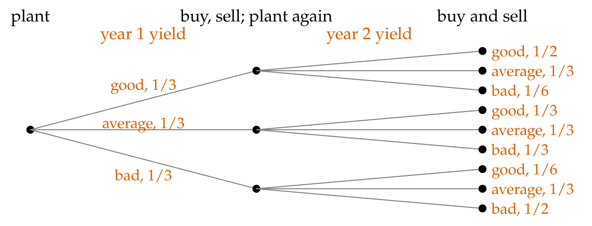

```{julia}
#| output: false
import Pkg
Pkg.activate(@__DIR__)
Pkg.instantiate()
```

```{julia}
#| output: false
using Plots
using Measures
using LaTeXStrings
using JuMP
using HiGHS

plot_font = "Palatino Roman"
default(
    fontfamily=plot_font,
    linewidth=3,
    framestyle=:box,
    label=nothing,
    grid=false,
    guidefontsize=18,
    legendfontsize=16,
    tickfontsize=16,
    titlefontsize=20,
    bottom_margin=10mm,
    left_margin=5mm
)

# Okabe-Ito palette: distinguishable under all common types of color
# blindness, and every pair also differs in line style so the figures
# still read in grayscale.
cb_orange = "#E69F00"
cb_green = "#009E73"
cb_yellow = "#F0E442"
cb_blue = "#0072B2"
cb_vermillion = "#D55E00"
cb_purple = "#CC79A7"
```

```{julia}
#| output: false

# The reservoir: storage in whole units, 0 to 4; start full.
# Each month: release r (at most what is stored), then that month's inflow
# arrives; anything above capacity spills.
capacity = 4
start_storage = 4
inflow = [1, 1, 0]                       # a three-month dry season
benefit_table = [0, 6, 10, 12, 13]       # benefit of releasing 0, 1, 2, 3, 4 units
benefit(r) = benefit_table[r + 1]
next_storage(s, r, q) = min(s - r + q, capacity)
n_months = length(inflow)
levels = 0:capacity

# Greedy: release everything available every month
greedy_release = zeros(Int, n_months)
let s = start_storage
    for t in 1:n_months
        greedy_release[t] = s
        s = next_storage(s, s, inflow[t])
    end
end
greedy_total = sum(benefit.(greedy_release))

# The hand calculation, written out for months 3 and 2 only
# (the general function comes later and is checked against these)
value_month3 = zeros(Int, capacity + 1)
for s in levels
    value_month3[s + 1] = benefit(s)                  # last month: release everything
end
value_month2 = fill(-1, capacity + 1)
release_month2 = zeros(Int, capacity + 1)
for s in levels
    for r in 0:s
        total = benefit(r) + value_month3[next_storage(s, r, inflow[2]) + 1]
        if total > value_month2[s + 1]                # ties keep the smaller release
            value_month2[s + 1] = total
            release_month2[s + 1] = r
        end
    end
end

# Print whole numbers without a decimal point
function fmt(x)
    rounded_x = round(x; digits=2)
    if isinteger(rounded_x)
        return string(Int(rounded_x))
    end
    return string(rounded_x)
end
commas(n) = replace(string(round(Int, n)), r"(?<=\d)(?=(\d{3})+$)" => ",")
```

```{julia}
#| output: false

# The farmer (Birge and Louveaux), from the two-stage example: wheat, corn and
# sugar beets on 500 acres, planted before the yield is known
land = 500                         # [acres]
plant_cost = [150, 230, 260]       # [$/acre]
avg_yield = [2.5, 3, 20]           # [T/acre] in an average year
feed_need = [200, 240]             # [T] of wheat and corn needed for feed
sell_price = [170, 150]            # [$/T] wheat and corn
buy_price = 1.4 .* sell_price      # buying costs 40% more than selling
beet_price = 36                    # [$/T] up to the quota
beet_quota = 6000                  # [T]
beet_excess_price = 10             # [$/T] above the quota
scenarios = ["Good", "Average", "Bad"]
yield_factor = [1.2, 1, 0.8]       # yields relative to average
prob = fill(1 / 3, 3)

# The two-stage farm model: one planting x, and purchases y and sales z for each
# scenario. Passing `plan` fixes the planting. Returns the planting and the
# expected profit.
function farm_model(factors, probs; plan=nothing)
    n = length(factors)
    model = Model(HiGHS.Optimizer)
    set_silent(model)
    @variable(model, x[1:3] >= 0)
    @variable(model, y[1:2, 1:n] >= 0)
    @variable(model, z[1:4, 1:n] >= 0)
    if plan !== nothing
        @constraint(model, x .== plan)
    end
    @constraint(model, sum(x) <= land)
    for s in 1:n
        crop_yield = avg_yield .* factors[s]
        @constraint(model, crop_yield[1] * x[1] + y[1, s] - z[1, s] >= feed_need[1])
        @constraint(model, crop_yield[2] * x[2] + y[2, s] - z[2, s] >= feed_need[2])
        @constraint(model, z[3, s] + z[4, s] <= crop_yield[3] * x[3])
        @constraint(model, z[3, s] <= beet_quota)
    end
    @objective(model, Max, -sum(plant_cost .* x) + sum(probs[s] * (
        sell_price[1] * z[1, s] + sell_price[2] * z[2, s] + beet_price * z[3, s] +
        beet_excess_price * z[4, s] - buy_price[1] * y[1, s] - buy_price[2] * y[2, s])
        for s in 1:n))
    optimize!(model)
    return value.(x), objective_value(model)
end

# The two-stage plan, for one year with three equally likely year types
stochastic_plan, stochastic_profit = farm_model(yield_factor, prob)
```

# Review of Last Class

## Two-Stage Problems with Recourse

- The farmer plants wheat, corn and beets before the yield is known, then buys and sells once the harvest is in.
- Two-stage problems: **one** here-and-now decision, **one recourse decision per scenario**, weighted by probability.
- A **scenario tree** lays out the scenarios: each path from the root to a leaf is one.

## Questions?



# Multi-Stage Scenario Trees

## Multi-Stage Trees

Suppose good years tend to follow good years and bad follow bad, so year 2's probabilities depend on year 1's yield.

{width=100% fig-alt="Scenario tree over two years: planting, three year 1 yields with probability 1/3 each, a node for each with buying, selling and the year 2 planting, then three year 2 yields whose probabilities depend on year 1: after a good year, good 1/2, average 1/3, bad 1/6; after an average year, 1/3 each; after a bad year, good 1/6, average 1/3, bad 1/2."}

::: {.notes}
Each year on its own is still good, average or bad with probability 1/3; only the sequence of years changes. The tree figure is drawn by `figures/scenario-trees.jl`.
:::

## Probabilities Along a Path

**How likely are two bad years in a row? A good year, then a bad one?**

::: {.fragment .fade-in}
Multiply the branch probabilities along the path, each conditional on the branches before it:

$$
\begin{aligned}
P(\text{bad}, \text{bad}) &= \tfrac{1}{3} \times \tfrac{1}{2} = \tfrac{1}{6} \\
P(\text{good}, \text{bad}) &= \tfrac{1}{3} \times \tfrac{1}{6} = \tfrac{1}{18}
\end{aligned}
$$

If the years were independent, both would be $\frac{1}{9}$.
:::

## Two-Year Decision Variables

Let $a$ be year 1's yield and $b$ year 2's, each G, A or B (good, average, bad). **Which yields can each decision depend on?**

::: {.fragment .fade-in}
- $\mathbf{x}^{(1)}$: year 1 planting, before any yield is known
- $\mathbf{y}^{(1)}_a$, $\mathbf{z}^{(1)}_a$: year 1 purchases and sales, after year 1's yield
- $\mathbf{x}^{(2)}_a$: year 2 planting, after year 1's yield but before year 2's
- $\mathbf{y}^{(2)}_{ab}$, $\mathbf{z}^{(2)}_{ab}$: year 2 purchases and sales, after both
:::

::: {.notes}
Each variable is indexed by the yields known when it is decided, so the subscripts match the nodes of the tree: one year 1 planting, three sets of year 1 purchases and sales, three year 2 plantings, and nine sets of year 2 purchases and sales.
:::

## Two-Year Objective

$$
\begin{aligned}
\max \quad & -\mathbf{c}^\top \mathbf{x}^{(1)} + \sum_a p_a \Big[ r\big(\mathbf{y}^{(1)}_a, \mathbf{z}^{(1)}_a\big) - \mathbf{c}^\top \mathbf{x}^{(2)}_a \\
& \qquad + \sum_b p_{b \mid a}\, r\big(\mathbf{y}^{(2)}_{ab}, \mathbf{z}^{(2)}_{ab}\big) \Big]
\end{aligned}
$$

$r$ is the money from sales minus purchases, and $p_{b \mid a}$ the probability of year 2 yield $b$ after year 1 yield $a$. The year 2 planting cost sits outside the sum over $b$: one planting for all three year 2 outcomes.

::: {.notes}
The constraints follow the same indexing. On path $ab$, year 2's wheat feed constraint is $2.5 f_b\, x^{(2)}_{1,a} + y^{(2)}_{1,ab} - z^{(2)}_{1,ab} \geq 200$, where $f_b$ is the yield factor for year 2 yield $b$: the same planting $x^{(2)}_{1,a}$ appears in the constraints for all three values of $b$. The year 1 constraints are the two-stage ones, with $\mathbf{x}^{(1)}$ and $f_a$.
:::

## Non-Anticipativity

**Why $\mathbf{x}^{(2)}_a$ and not $\mathbf{x}^{(2)}_{ab}$, like the year 2 sales?**

::: {.fragment .fade-in}
With $\mathbf{x}^{(2)}_{ab}$, the planting for path BG could be chosen knowing year 2 will be good. A decision can depend only on what is known when it is made: **non-anticipativity**. Indexing by $a$ alone is the same as requiring

$$\mathbf{x}^{(2)}_{aG} = \mathbf{x}^{(2)}_{aA} = \mathbf{x}^{(2)}_{aB} \quad \text{for each } a.$$
:::

::: {.notes}
The year 2 planting is recourse for year 1 but a here-and-now decision for year 2, which is why the two-stage rule of one recourse copy per scenario doesn't carry over. Indexing it by $ab$ would solve without error and plan as if each year 2 yield were known, overstating the expected profit. In the two-stage model the single planting $\mathbf{x}$ already satisfies non-anticipativity; giving each year type its own planting would give the perfect-information plans, whose extra expected profit is the EVPI. Because each node knows the whole path to it, a tree can carry any dependence on the past, as $p_{b \mid a}$ does here.
:::

## Variables in `JuMP`

```{julia}
#| echo: true
#| output: false
#| code-fold: false
#| code-line-numbers: "|3|4-5|6|7-8"

two_year = Model(HiGHS.Optimizer)
@variables(two_year, begin
    x1[1:3] >= 0                        # x^(1): year 1 planting
    y1[1:2, a in 1:3] >= 0              # y^(1)_a: year 1 purchases
    z1[1:4, a in 1:3] >= 0              # z^(1)_a: year 1 sales
    x2[1:3, a in 1:3] >= 0              # x^(2)_a: year 2 planting
    y2[1:2, a in 1:3, b in 1:3] >= 0    # y^(2)_ab: year 2 purchases
    z2[1:4, a in 1:3, b in 1:3] >= 0    # z^(2)_ab: year 2 sales
end)
```

Each variable gets an index for each yield known when it is decided: `x2` has one for `a` but none for `b`.

## Objective in `JuMP`

```{julia}
#| echo: true
#| output: false
#| code-fold: false
#| code-line-numbers: "|1-2|4-8|10|11|12-13|14"

# p_{b|a}: probability of year 2 yield b (column) after year 1 yield a (row)
persistence = [1/2 1/3 1/6; 1/3 1/3 1/3; 1/6 1/3 1/2]

function net_sales(y, z)    # r(y, z): money from sales minus purchases
    sales = sell_price[1] * z[1] + sell_price[2] * z[2] +
        beet_price * z[3] + beet_excess_price * z[4]
    return sales - buy_price[1] * y[1] - buy_price[2] * y[2]
end

@objective(two_year, Max, -sum(plant_cost .* x1) + sum(prob[a] * (
    net_sales(y1[:, a], z1[:, a]) - sum(plant_cost .* x2[:, a]) +
    sum(persistence[a, b] * net_sales(y2[:, a, b], z2[:, a, b])
        for b in 1:3))
    for a in 1:3))
```

`prob[a]` is $p_a$ and `persistence[a, b]` is $p_{b \mid a}$; the year 2 planting cost sits outside the sum over `b`.

## Constraints in `JuMP`

```{julia}
#| echo: true
#| output: false
#| code-fold: true

# One year's feed and beet constraints, for planting x, purchases y and
# sales z, in a year with yield factor f: the same as in the two-stage model
function add_year_constraints!(model, x, y, z, f)
    crop_yield = avg_yield .* f
    @constraint(model, crop_yield[1] * x[1] + y[1] - z[1] >= feed_need[1])
    @constraint(model, crop_yield[2] * x[2] + y[2] - z[2] >= feed_need[2])
    @constraint(model, z[3] + z[4] <= crop_yield[3] * x[3])
    @constraint(model, z[3] <= beet_quota)
end
```

```{julia}
#| echo: true
#| output: false
#| code-fold: false
#| code-line-numbers: "|1|2-5|6-10|12-13"

@constraint(two_year, sum(x1) <= land)
for a in 1:3
    # year 1, after yield a
    add_year_constraints!(two_year, x1, y1[:, a], z1[:, a], yield_factor[a])
    @constraint(two_year, sum(x2[:, a]) <= land)
    for b in 1:3
        # year 2, after yields a and b: the same x2[:, a] for every b
        add_year_constraints!(two_year, x2[:, a], y2[:, a, b], z2[:, a, b],
            yield_factor[b])
    end
end
set_silent(two_year)
optimize!(two_year)
```

The year 2 constraints use the same `x2[:, a]` for every `b`.

::: {.notes}
One year 2 planting serves the three year 2 outcomes after yield `a`: that indexing is non-anticipativity. `add_year_constraints!` adds one year's feed and beet constraints, the same as in the two-stage model.
:::

## Two-Year Planting Plan

```{julia}
#| echo: true
#| code-fold: true
#| output: asis

# The year 2 planting x^(2)_a after each year 1 yield a
println("| Year 1 yield | Wheat (acres) | Corn (acres) | Beets (acres) |")
println("|:--|--:|--:|--:|")
for a in 1:3
    println("| ", scenarios[a], " | ", join(fmt.(value.(x2[:, a])), " | "), " |")
end
```

```{julia}
#| echo: false
#| output: false

# The same plans from the two-stage model at each year 1 node, since nothing is
# carried between the years; the notes use their expected year 2 profits
year2_plan = zeros(3, 3)
year2_profit = zeros(3)
# the original two-stage plan, kept in year 2, with the same probabilities
original_plan_profit = zeros(3)
for a in 1:3
    year2_plan[a, :], year2_profit[a] = farm_model(yield_factor, persistence[a, :])
    original_plan_profit[a] = farm_model(yield_factor, persistence[a, :];
        plan=stochastic_plan)[2]
end
@assert is_solved_and_feasible(two_year)
@assert isapprox(value.(x1), stochastic_plan; atol=1e-6)
for a in 1:3
    @assert isapprox(value.(x2[:, a]), year2_plan[a, :]; atol=1e-6)
end
@assert isapprox(objective_value(two_year), stochastic_profit + sum(prob .* year2_profit); atol=1e-3)

# The probabilities on the tree and the earlier slides
for i in 1:3
    @assert isapprox(sum(persistence[i, :]), 1) && isapprox(sum(persistence[:, i]), 1)
end
@assert persistence[3, 3] == 1 / 2 && persistence[1, 3] == 1 / 6
# After a good or an average year the plan is unchanged; after a bad year the
# wheat and corn just cover the feed in another bad year, and the new plan
# earns more than keeping the original one
for i in 1:2
    @assert isapprox(year2_plan[i, :], stochastic_plan; atol=1e-6)
end
@assert isapprox(year2_plan[3, 1] * avg_yield[1] * yield_factor[3], feed_need[1]; atol=1e-6)
@assert isapprox(year2_plan[3, 2] * avg_yield[2] * yield_factor[3], feed_need[2]; atol=1e-6)
bad_year_gain = year2_profit[3] - original_plan_profit[3]
@assert bad_year_gain > 1
```

After a bad year, the farmer plants enough wheat and corn to cover the feed even if year 2 is bad too.

::: {.notes}
With nothing carried between the years, the year 1 planting is the two-stage plan, `{julia} join(fmt.(stochastic_plan), "/")` acres, and so is the year 2 planting after a good or an average year. After a bad year, another bad year has probability 1/2: the plan grows `{julia} fmt(year2_plan[3, 1])` acres of wheat and `{julia} fmt(year2_plan[3, 2])` of corn, just enough for the feed in a bad year, and `{julia} fmt(year2_plan[3, 3])` of beets. The expected year 2 profit is \$`{julia} commas(year2_profit[1])` after a good year, \$`{julia} commas(year2_profit[2])` after an average one and \$`{julia} commas(year2_profit[3])` after a bad one.
:::

## Scenario Trees Grow Fast

```{julia}
#| echo: false
#| output: asis

# With three yield outcomes a year: 3^T leaves after T years, and
# 1 + 3 + ... + 3^T nodes, each with its own copy of the decisions made there
println("| Years | Scenarios (leaves) | Nodes |")
println("|:--|--:|--:|")
for n_years in [1, 2, 3, 5, 10]
    n_nodes = 0
    for t in 0:n_years
        n_nodes = n_nodes + 3^t
    end
    println("| ", n_years, " | ", commas(3^n_years), " | ", commas(n_nodes), " |")
end
```

**Raises the question**: how do we make decisions in a **sequence** without writing out the tree?

::: {.notes}
With a decision and an uncertainty every year, the number of scenarios grows exponentially with the number of years. Each node carries its own copy of the decisions made there, so the model grows with the number of nodes. Sampling a finite set of branches is one way to keep a tree small. Most environmental decisions repeat: release water every month, set a loading every year, harvest every season. Writing out every path through the future quickly becomes impossible, and dynamic programming is the standard way around it.
:::

# Sequential Decisions

## Decisions Linked Over Time

- **Reservoir**: water released this month is not there next month.
- **Lake**: $P_{t+1} = P_t + L_t - sP_t + R(P_t)$. This year's loading $L_t$ changes next year's phosphorus $P_{t+1}$.
- **Fishery**: this season's harvest changes next season's stock.

**Why not just optimize each month on its own?**

::: {.notes}
Each example has a stock that carries the past into the future, so today's decision changes tomorrow's options.
:::

## A Reservoir in a Dry Season

- Storage holds up to **`{julia} capacity` units**, and starts **full**.
- Each month: **release** $r$ (at most what is stored), then the month's **inflow** arrives; anything above `{julia} capacity` spills.
- Inflows over the season: `{julia} join(inflow, ", ")`.
- Benefit of a month's release:

```{julia}
#| echo: false
#| output: asis

println("| Release | ", join(0:capacity, " | "), " |")
println("|:--|", repeat("--:|", capacity + 1))
println("| **Benefit** | ", join(benefit_table, " | "), " |")
```

::: {.notes}
The benefits have diminishing returns: the first unit released in a month is worth 6, the second only 4 more, the third 2, the fourth 1. Think of water for irrigation or a city during a dry season.
:::

## The Greedy Plan

**Greedy**: release everything available, every month.

It releases `{julia} join(greedy_release, ", ")`, for a total benefit of **`{julia} greedy_total`**.

**Can you beat `{julia} greedy_total`?**

::: {.fragment .fade-in}
Releasing 2, 2, 2 gives a total of **`{julia} 3 * benefit(2)`**.
:::

::: {.notes}
Greedy maximizes each month's benefit separately: it empties the reservoir in month 1, then only has the inflow. The harder question is how to find the best plan when there are more months, more storage levels, or uncertain inflows: trial and error does not scale.
:::

## Elements of a Dynamic Program

- **Stage** $t$: the month.
- **State** $s_t$: storage at the start of the month; it carries the past forward.
- **Decision** $r_t$: the release, with $0 \leq r_t \leq s_t$.
- **Transition**: $s_{t+1} = \min(s_t - r_t + I_t,\ `{julia} capacity`)$.
- **Value function** $V_t(s)$: the best total benefit from month $t$ to the end, starting with storage $s$.
- **Policy**: the best release for each month and storage level.

::: {.notes}
The value function is the key idea: it answers "how good is it to be here?" for every state, not only the one we start in. Once we know next month's value function, choosing this month's release is a one-step problem.
:::

# Backward Induction

## The Last Month

In the **last month**, this model gives water left over no value, so release everything:

```{julia}
#| echo: false
#| output: asis

println("| Storage | ", join(levels, " | "), " |")
println("|:--|", repeat("--:|", capacity + 1))
println("| **Best release** | ", join(levels, " | "), " |")
println("| **Value** $(raw"$V_3(s)$") | ", join(value_month3, " | "), " |")
```

Now step **backwards**: knowing $V_3$, month 2 is a one-step problem.

::: {.notes}
The last stage is the easy one, because no later month depends on it. That is why we start there.
:::

## Month 2 by Hand

For each storage $s$, try every release $r \leq s$ (month 2's inflow is $I_2 =$ `{julia} inflow[2]`):

$$V_2(s) = \max_{r \leq s} \left[\, \text{benefit}(r) + V_3\big(\min(s - r + I_2,\ 4)\big) \right]$$

**Your turn: compute $V_2(3)$.**

::: {.fragment .fade-in}
```{julia}
#| echo: false
#| output: asis

println("| Storage | ", join(levels, " | "), " |")
println("|:--|", repeat("--:|", capacity + 1))
println("| **Best release** | ", join(release_month2, " | "), " |")
println("| **Value** $(raw"$V_2(s)$") | ", join(value_month2, " | "), " |")
```
:::

::: {.notes}
Board item. Work V2(0) and V2(1) together on the board, then let students compute V2(3). For s = 3 the options are: release 0, benefit 0 plus V3 of min(3 + 1, 4) = 13, so 13; release 1, 6 plus V3(3) = 12, so 18; release 2, 10 plus V3(2) = 10, so 20; release 3, 12 plus V3(1) = 6, so 18. The best is 20, releasing 2. Fill in the rest of the table. At storage 2 and storage 4 two releases tie (1 or 2, and 2 or 3); the table reports the smaller one.
:::

## Backward Induction in Code

```{julia}
#| echo: true
#| code-fold: false
#| output: false

function backward_induction(inflow; end_value=zeros(capacity + 1))
    value = fill(-Inf, capacity + 1, n_months + 1)  # best total from month t
    policy = zeros(Int, capacity + 1, n_months)     # best release
    value[:, n_months + 1] = end_value              # water left at the end
    for t in n_months:-1:1, s in levels
        for r in 0:s                                # at most what is stored
            total = benefit(r) + value[next_storage(s, r, inflow[t]) + 1, t + 1]
            if total > value[s + 1, t]              # ties keep the smaller r
                value[s + 1, t] = total
                policy[s + 1, t] = r
            end
        end
    end
    return value, policy
end
```

::: {.notes}
The code is the hand calculation in a loop: months backwards, every storage level, every allowed release (no more than is stored). It keeps one table of values and one table of best releases, both allocated at full size before the loop. A release replaces the best so far only if it is strictly better, so ties keep the smaller release, as on the board.
:::

## Month 1 and the Optimal Plan

```{julia}
#| echo: false
#| output: false

dp_value, policy = backward_induction(inflow)

# The function reproduces the hand calculation
@assert dp_value[:, 3] == value_month3
@assert dp_value[:, 2] == value_month2

# Follow the policy forward from a full reservoir
dp_release = zeros(Int, n_months)
let s = start_storage
    for t in 1:n_months
        dp_release[t] = policy[s + 1, t]
        s = next_storage(s, dp_release[t], inflow[t])
    end
end
dp_total = sum(benefit.(dp_release))
```

```{julia}
#| echo: false
#| output: asis

println("| Storage | ", join(levels, " | "), " |")
println("|:--|", repeat("--:|", capacity + 1))
println("| **Best release** | ", join(policy[:, 1], " | "), " |")
println("| **Value** $(raw"$V_1(s)$") | ", join(Int.(dp_value[:, 1]), " | "), " |")
```

From a full reservoir, $V_1(`{julia} start_storage`) =$ **`{julia} Int(dp_value[start_storage + 1, 1])`**. Following the policy forward gives releases **`{julia} join(dp_release, ", ")`**.

::: {.notes}
The value function at the start answers the whole problem: `{julia} Int(dp_value[start_storage + 1, 1])`, against greedy's `{julia} greedy_total`. To get the plan, follow the policy forward: release 2, see the storage, look up the next month's best release, and so on.
:::

## Checking by Brute Force

```{julia}
#| echo: true
#| code-fold: true
#| output: false

# Try every release sequence (only feasible because the problem is tiny)
function brute_force()
    best_total = -1
    n_best = 0                  # how many sequences reach the best total
    for r1 in 0:start_storage
        s2 = next_storage(start_storage, r1, inflow[1])
        for r2 in 0:s2
            s3 = next_storage(s2, r2, inflow[2])
            for r3 in 0:s3
                total = benefit(r1) + benefit(r2) + benefit(r3)
                if total > best_total
                    best_total = total
                    n_best = 1
                elseif total == best_total
                    n_best += 1
                end
            end
        end
    end
    return best_total, n_best
end
best_total, n_best = brute_force()
```

Trying every release sequence gives the same best total, **`{julia} best_total`**, and only one sequence reaches it.

::: {.notes}
On a problem this small we can try every sequence. On a realistic problem we cannot, so we check the method on cases where we can.
:::

## Why Spread the Water?

```{julia}
#| echo: true
#| code-fold: true
#| label: fig-releases
#| fig-cap: "Monthly releases under the greedy plan and the dynamic programming plan."

months = 1:n_months
p_releases = bar(months .- 0.18, greedy_release, bar_width=0.35, color=cb_vermillion, linecolor=:black,
    label="Greedy (total $(greedy_total))", xlabel="Month", ylabel="Release  [units]",
    legend=:topright, ylims=(0, 5), xticks=months)
bar!(p_releases, months .+ 0.18, dp_release, bar_width=0.35, color=cb_blue, linecolor=:black,
    fillstyle=:/, label="DP (total $(dp_total))")
plot!(p_releases, size=(1050, 330), left_margin=10mm, bottom_margin=10mm)
```

Here, with diminishing returns, the best plan releases the same amount every month.

::: {.notes}
With diminishing returns, moving a unit from a month with a large release to one with a small release gains, as long as storage allows the move. Greedy ignores that the water could have been used later.
:::

# Uncertain Inflows

## Releasing Before the Inflow Is Known

Inflow is **0 or 2 units**, equally likely, and is unknown when we release, so we use the **expected** next value:

$$
\begin{aligned}
V_t(s) = \max_{r \leq s} \Big[\, \text{benefit}(r) &+ \tfrac{1}{2} V_{t+1}\big(\min(s - r, 4)\big) \\
&+ \tfrac{1}{2} V_{t+1}\big(\min(s - r + 2, 4)\big) \Big]
\end{aligned}
$$

The backward pass is the same, and the answer is a **policy**: the best release for each storage level.

::: {.notes}
The only change from the deterministic case is that the next storage depends on an inflow we do not know yet, so we average the next month's value over the two possibilities. Because we cannot know the future storage, the useful answer is a rule: what to release for any storage we might find ourselves in.
:::

## Hedging

```{julia}
#| echo: true
#| code-fold: true
#| output: false

inflow_outcomes = [0, 2]
inflow_probs = [0.5, 0.5]

function backward_induction_uncertain(n_periods)
    value = fill(-Inf, capacity + 1, n_periods + 1)
    value[:, n_periods + 1] .= 0
    policy = zeros(Int, capacity + 1, n_periods)
    for t in n_periods:-1:1
        for s in levels
            for r in 0:s
                # average next month's value over the possible inflows
                expected_next = 0.0
                for k in eachindex(inflow_outcomes)
                    next_s = next_storage(s, r, inflow_outcomes[k])
                    expected_next = expected_next + inflow_probs[k] * value[next_s + 1, t + 1]
                end
                total = benefit(r) + expected_next
                if total > value[s + 1, t]
                    value[s + 1, t] = total
                    policy[s + 1, t] = r
                end
            end
        end
    end
    return value, policy
end

value_u, policy_u = backward_induction_uncertain(n_months)

# Expected benefit of releasing everything every month, from storage s in month t
function release_all_expected(s, t)
    if t > n_months
        return 0.0
    end
    expected_next = 0.0
    for k in eachindex(inflow_outcomes)
        next_s = next_storage(s, s, inflow_outcomes[k])
        expected_next = expected_next + inflow_probs[k] * release_all_expected(next_s, t + 1)
    end
    return benefit(s) + expected_next
end
release_all_value = release_all_expected(start_storage, 1)
```

From a full reservoir the policy releases **`{julia} policy_u[start_storage + 1, 1]`** and keeps `{julia} start_storage - policy_u[start_storage + 1, 1]` in case the inflow is 0. Its expected benefit is **`{julia} fmt(value_u[start_storage + 1, 1])`**; releasing everything every month has an expected benefit of `{julia} fmt(release_all_value)`.

::: {.notes}
Even though the reservoir is full and inflow might come, the policy releases only `{julia} policy_u[start_storage + 1, 1]` in the first month: holding water is insurance against a dry month. That is hedging. Releasing everything immediately does much worse in expectation.
:::

## Check It Against the Scenario Tree

```{julia}
#| echo: true
#| code-fold: true
#| output: false

# The scenario-tree method: a decision at every node of the tree, then the best
# expected value, by brute-force recursion over all branches
function tree_value(s, t)
    if t > n_months
        return 0.0
    end
    best = -Inf
    for r in 0:s
        expected = 0.0
        for k in eachindex(inflow_outcomes)
            next_s = next_storage(s, r, inflow_outcomes[k])
            expected = expected + inflow_probs[k] * tree_value(next_s, t + 1)
        end
        best = max(best, benefit(r) + expected)
    end
    return best
end
tree_best = tree_value(start_storage, 1)
```

Enumerating every branch of the scenario tree gives **`{julia} fmt(tree_best)`**, and dynamic programming gives the same **`{julia} fmt(value_u[start_storage + 1, 1])`**.

::: {.notes}
The tree allows a different decision at every node; dynamic programming gets the same optimum because the best decision at a node depends only on the storage there, not on how we got there. That property is what lets the table replace the tree. It relies on the inflows being independent from month to month: with persistence like the farmer's yields, the best release would also depend on last month's inflow, so the state would have to include it.
:::

## Trees Versus Tables

```{julia}
#| echo: false
#| output: asis

println("| Months | Tree leaves | DP table entries |")
println("|:--|--:|--:|")
for T in [3, 6, 12]
    println("| ", T, " | ", commas(length(inflow_outcomes)^T), " | ", (capacity + 1) * T, " |")
end
```

With 2 inflow outcomes a month and 5 storage levels, the tree grows exponentially with the number of months; the table grows linearly.

::: {.notes}
The tree records every possible history; the table records only the states that matter for the future. The appendix shows that the table grows exponentially with the number of state variables instead: the curse of dimensionality.
:::

## What Is Water Worth at the End?

```{julia}
#| echo: true
#| code-fold: true
#| output: asis

carryover_values = [0, 3, 6]          # value of each unit left in storage at the end
println("| Value per unit left at the end | Releases | Storage left |")
println("|:--|:--|--:|")
for c in carryover_values
    v, pol = backward_induction(inflow; end_value=c .* levels)
    rel = zeros(Int, n_months)
    s = start_storage
    for t in 1:n_months
        rel[t] = pol[s + 1, t]
        s = next_storage(s, rel[t], inflow[t])
    end
    println("| ", c, " | ", join(rel, ", "), " | ", s, " |")
end
```

The **end-of-horizon value** is a modeling choice that can change the plan: what is water left at the end of the dry season worth?

::: {.notes}
With no value on leftover water, the plan empties the reservoir by the end of the season. Value leftover water at 6 per unit and the plan holds most of it back. Neither is wrong: it depends on whether the reservoir refills in winter. The default today, zero, assumes it does.
:::

# Key Takeaways

## Key Takeaways (Scenario Trees)

- Each **node** of a scenario tree has its own decisions; a scenario's probability is the product of the branch probabilities along its path, each conditional on the branches before it.
- **Non-anticipativity**: a decision can depend only on what is known when it is made.
- **Scenario trees grow multiplicatively** with every stage that has its own decision and uncertainty.

## Key Takeaways (DP)

- A **sequential decision** has stages, a **state** that carries the past forward, and a **transition**; deciding each month on its own (greedy) can be badly wrong.
- **Backward induction**: start at the end, keep one **value function** per stage, step backwards.
- Under uncertainty, DP returns a **policy** and matches the scenario tree's answer, with a table that grows linearly in the number of stages, where the tree grows exponentially.
- End-of-horizon values can change the whole plan.

# Upcoming Schedule

## Next Classes

**Monday, November 23**: Lab 4, reservoir operations (bring a laptop).

**Wednesday, November 25**: No class (Thanksgiving).

**Monday, November 30**: Multiple objectives, robustness, and sensitivity.

## Assessments

**HW8**: due Thursday, November 19. **MP2**: due Friday, November 20.

**HW9**: assigned today, due Thursday, December 3 (stochastic optimization and dynamic programming).

**Quiz 6**: Monday, December 7.

# Appendix

## The Bellman Recursion

In general notation, with state $s$, decision $r$, benefit $b$, and random inflow $I$:

$$V_t(s) = \max_{r} \left\{ b(r) + \mathbb{E}_I\left[V_{t+1}\big(f(s, r, I)\big)\right] \right\}$$

$$V_{T+1}(s) = \text{terminal value}$$

where $f$ is the transition.

## The Curse of Dimensionality

```{julia}
#| echo: false
#| output: asis

println("| Reservoirs | Storage states (", capacity + 1, " levels each) |")
println("|:--|--:|")
for n in [1, 2, 10]
    println("| ", n, " | ", commas((capacity + 1)^n), " |")
end
```

The table grows exponentially with the number of state variables: the **curse of dimensionality**.

## Does the Storage Grid Matter?

```{julia}
#| echo: true
#| code-fold: true
#| output: asis

# Finer storage grids, with the benefit interpolated linearly between table points
function benefit_interp(r)
    if r >= capacity
        return Float64(benefit_table[end])
    end
    k = floor(Int, r)
    fraction = r - k
    return (1 - fraction) * benefit_table[k + 1] + fraction * benefit_table[k + 2]
end

function best_from_full(spacing)
    grid = 0:spacing:capacity
    n = length(grid)
    value = zeros(n, n_months + 1)
    for t in n_months:-1:1
        for i in 1:n
            s = grid[i]
            best = -Inf
            for r in 0:spacing:s
                j = round(Int, min(s - r + inflow[t], capacity) / spacing) + 1
                best = max(best, benefit_interp(r) + value[j, t + 1])
            end
            value[i, t] = best
        end
    end
    return value[end, 1]
end

println("| Grid spacing (units) | Best total from a full reservoir |")
println("|:--|--:|")
for spacing in [1, 0.5, 0.25]
    println("| ", fmt(spacing), " | ", fmt(best_from_full(spacing)), " |")
end
```

Refining the grid to spacings of 0.5 and 0.25 units gives the same best total.

## The Lake as a Dynamic Program

- **State**: phosphorus $P_t$ in the lake.
- **Decision**: loading $L_t$ each year.
- **Transition**: $P_{t+1} = P_t + L_t - sP_t + R(P_t)$.
- **Benefit**: the value of the loading (farm output, wastewater), minus damages when the lake is eutrophic.

A continuous state with a threshold needs a fine grid in $P$.
